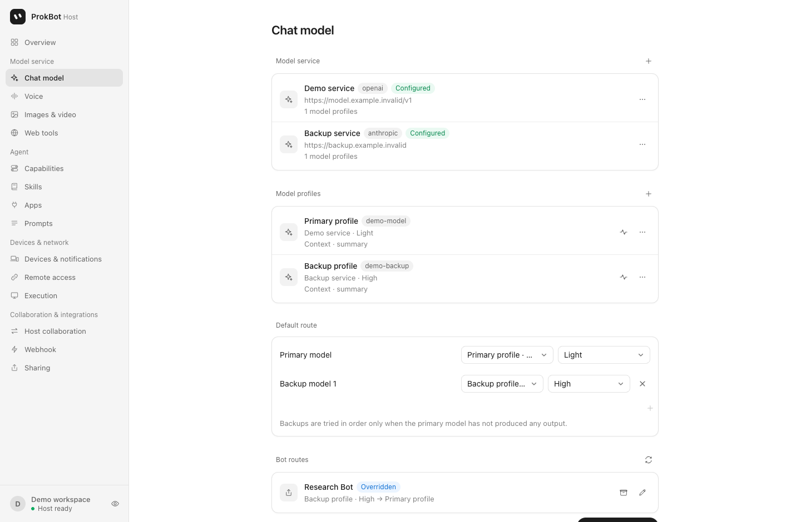

<div align="center">

# ProkBot Plus

**Run Grok Bot on your own server, with the models you choose.**

Windows · macOS · iOS client patches ｜ [Our own Android app (unofficial)](#android-client) ｜ Server on x86_64 and ARM64 Linux ｜ OpenAI Chat, OpenAI Responses and Anthropic Messages APIs

<p>
<!-- client-badges:start -->
  <a href="#client-versions"></a>
  <a href="#client-versions"></a>
  <a href="#client-versions"></a>
  <a href="#client-versions"></a>
  <a href="#client-versions"></a>
<!-- client-badges:end -->
  
  
  <a href="https://linux.do"></a>
</p>

[简体中文](README.md) · **English**

</div>

<p align="center">
  
</p>
<p align="center"><sub>The Windows client. One message gets the Bot to look something up, cite its sources and draw a picture. The model, web access and image generation all go through your own APIs. (The screenshots show the Chinese UI; the apps also support English.)</sub></p>

## What is this

Grok Bot is xAI's AI assistant app, with clients for Windows, Mac, iPhone and more. Its Bot does more than chat: it has its own Linux computer where it runs commands, opens a browser and works with files, and it has memory and scheduled tasks. But the original apps can only connect to the official cloud.

The open-source project [ProkBot](https://gitee.com/ahaduoduoduo/ProkBot) moves the server side (the Host and the Bot's Linux computer) onto your own server with Docker, then patches the original apps so they connect to your server. **ProkBot Plus** builds on it:

- Adds a **Windows client** and **our own Android app**;
- Adds two model APIs, **Anthropic Messages** and **OpenAI Responses** (upstream supports only OpenAI Chat);
- Fixes problems found in real use with web search, image generation, message order and local commands;
- Provides one tool for deployment, backup and upgrades, plus a deployment guide an AI can follow.

> This is an unofficial project with no connection to xAI or the official Grok Bot. Noncommercial use only. See [License and notices](#license-and-notices).

## What it does

- **Use the original Grok Bot.** The interface, Agent, tool calls, memory, scheduled tasks and action approvals are the original ones. Only the server is now in your hands.
- **Route the models you want.** Add Claude, GPT, DeepSeek, Grok, relays and aggregator gateways together when they support tool calls. Each Bot can have its own primary model, thinking effort and ordered backups; legacy difficulty-based routing remains available for existing configurations.
- **The Bot has its own computer.** The server comes with a Linux desktop. The Bot runs commands, opens a browser and handles files on it; you can watch it live or take over at any time.
- **Let the Bot use your computer.** On Mac it can run commands and operate the graphical interface. On Windows it can run commands, and it asks you in a pop-up before each one.
- **Web access and images.** Search and read web pages with the model's built-in web tools. Generate images with an OpenAI-compatible image API, in a set aspect ratio or from a reference image.
- **Your data stays with you.** Chats, files, memory and Bot data are stored on your server. Telemetry and automatic updates are turned off.
- **Works on your phone.** On iPhone and Android you can chat, get notifications and watch the Bot's computer.
- **Works when you're out.** Direct LAN connection, built-in Tailcat networking (no public IP needed), or your own HTTPS domain.

<a id="what-you-need-to-deploy"></a>
## Server requirements

The models run at your API provider, so **the server needs no GPU**. It only runs two Docker containers: the Host (the server program) and the Bot's Linux computer.

| | Minimum | Recommended |
| --- | --- | --- |
| CPU | 2 cores | 4 cores or more |
| Memory | 4 GB | 8 GB or more |
| Free disk space | 30 GB | 50 GB or more |
| System | 64-bit Linux, Docker with Docker Compose v2, Python 3.10+ | Ubuntu 24.04 + Docker 29 (the tested setup) |

This is enough for one person or a household. Heavy use by many people at once has not been tested. What these numbers are based on:

- **2 cores and 2 GB is not enough.** Both test runs failed to finish a series of chats in time, and the background model connection dropped and the core restarted.
- **2 cores / 4 GB and 4 cores / 8 GB both work.** Each was deployed from scratch and completed pairing, an attachment upload, several real chats and a cancellation; after a restart, chats and settings were all still there. A build from scratch takes about 9–10 minutes, depending on network speed.
- **Actual usage.** On the author's own server (6 cores, 16 GB), running for about a week: the Host uses about 0.7 GB of memory (peak 0.9 GB) and the Bot's computer about 0.8 GB (peak 1.7 GB). The images take about 13 GB of disk. Chat and file data start under 100 MB and grow with use.
- The first deployment downloads the official files and base images from the internet, and the build needs extra temporary space. Backups also take space.

**Ways to deploy**

| Your machines | How to deploy |
| --- | --- |
| One x86_64 Linux machine | **Recommended.** The Host and the Bot's computer run on the same machine. |
| One ARM64 Linux machine + one x86_64 Linux machine | The Host runs on the ARM machine (for example an Oracle Ampere A1) and the Bot's computer on the x86_64 machine. The Bot's computer only exists for x86_64. Chat and the remote desktop were tested on A1 earlier; the current version has not been retested on A1. |
| Only one ARM64 Linux machine | The x86_64 Bot computer runs under emulation on ARM. **Experimental** and clearly slower; the deploy tool checks whether it can run before installing. |

See the [AI deployment guide](docs/AI-INSTALL.en.md#choose-a-deployment) for the steps and the [technical documentation](docs/ARCHITECTURE.en.md#capacity-evidence) for the test records.

## What else you need

| Required | Notes |
| --- | --- |
| A model API | Any one of three formats: Anthropic Messages, OpenAI Responses, OpenAI Chat Completions. The model must support tool calls; for the Bot to operate a computer, it must also accept images. |
| A computer to build the clients | Needs Node.js 22.12+. Build the Windows client on Windows 10/11 x64 and the Mac client on an Apple Silicon Mac; the Android client builds on Windows, Mac or Linux. iPhone needs a decrypted IPA and a signing certificate. |
| The official installers | The patches only modify official originals you download yourself; see the [client version table](#client-versions) below for the versions. This project does not distribute official programs. |

| Optional | Used for |
| --- | --- |
| A model with native web access (for example Claude's `web_search`) | The Bot searches and reads web pages |
| An OpenAI-compatible image API | The Bot generates and edits images |
| Speech recognition and synthesis services | Voice input and real-time voice calls |
| Bark or an Apple push certificate | Push notifications on iPhone (not needed for Android) |
| A domain and HTTPS | Access from outside without Tailcat |

## Clients

<a id="client-versions"></a>
<!-- client-versions:start -->
**Which official version should I download?** The one in the right column; the patches accept only those versions. Where two versions are listed, use the recommended newer one first and switch to the older one only if it does not work. The left column is the latest official release (checked 2026-11-14); when it is newer, wait until this project supports it.

| Platform | Latest official | Version this project needs |
| --- | --- | --- |
| Windows x64 | [1.1.0](https://api2.cursor.sh/updates/api/download/stable/win32-x64-user/sand) | **1.1.0** (recommended); 0.71.2 if it does not work |
| macOS ARM64 | [1.1.0](https://api2.cursor.sh/updates/api/download/stable/darwin-arm64/sand) | 0.71.2 (not yet adapted to 1.1.0; not tested on a Mac) |
| iOS | [1.25.0](https://apps.apple.com/us/app/grok-bot/id6794501026) | 1.16.0 (build 23152; not tested on an iPhone or iPad) |
| Android 9+ (unofficial) | Does not use the official Android app | App **1.1.0** (build 10100), interface taken from the Windows **1.1.0** installer (recommended; 0.71.2 if it does not work) |
| Linux server | n/a | Host `d0a4baa`; Bot computer `9d2ac1b` (x86_64) |

ProkBot Plus has its own version numbers; see the [latest release](https://github.com/ferretgeek/prokbot-plus/releases/latest). The upstream ProkBot baseline is `3e9fe8c`.
<!-- client-versions:end -->

| Client | Requirements | Testing |
| --- | --- | --- |
| Windows | Windows 10 / 11 x64 | New in Plus. Tested on Windows 11: pairing, multi-turn chat, attachments, search, local commands, notifications and reading history back after a restart; the 0.71.2 fallback was also tested for pairing and chat. Comes as a portable version and an installer; no administrator rights needed. |
| Android | Android 9+, system WebView 89+ (111+ recommended) | Our own app, not the official Android app. Tested on Android 15 / 16 emulators: pairing, multi-turn real chats, reading history back and the notification permission. The 1.1.0 interface was also tested for the Bot computer view, images, search, dark mode and an older WebView. Not yet tested on a real phone. |
| Mac | Apple Silicon | Patch from upstream, still on the official 0.71.2: the Mac app is a separate package, so moving to 1.1.0 needs its own patch and testing on a Mac, which the maintainers don't have. The code shared with Windows is tested; this project has not tested it on a real Mac. |
| iPhone / iPad | Your own decrypted IPA and signing certificate | Patch from upstream. The patch tool is tested; this project has not tested it on an iPhone or iPad. |
| Linux desktop | — | No patch from this project. The official [Linux client](https://docs.x.ai/grok-bot/deployment) exists, but it is not the same thing as the Bot's Linux computer on the server. |

## Install

The easiest way: hand it to an AI that can run commands (Claude Code, Codex, Cursor and the like all work) and send it this:

```text
Please deploy ProkBot Plus for me: https://github.com/ferretgeek/prokbot-plus
First read docs/AI-INSTALL.en.md in the repository in full, then follow its steps exactly.
Ask about my machines, any existing instance, model and access method. Run doctor first. Never remove volumes, disclose keys or treat container startup as acceptance. Verify a two-turn client chat and a desktop action at the end.
```

The AI first lists what you need to prepare, then deploys the server, configures the model, builds the clients, and finally checks the result by actually chatting twice in a client.

To do it yourself, follow the [AI deployment guide](docs/AI-INSTALL.en.md). It is written for AI, but every step has the commands and how to check them, so a person can follow it too. On the server the flow is `doctor` (check the environment) → `init` (create the configuration) → `up` (build and start) → `status` (show the state); then set up the model and create a pairing code on the admin page, and connect with a client.

Downloads: the [latest release](https://github.com/ferretgeek/prokbot-plus/releases/latest) has five tool packages, for Host, Windows, Mac, iOS and Android, plus a `SHA256SUMS.txt` checksum file. Download the one you need. The packages contain no official programs and no patched clients; you build the clients on your own computer with the tools.

## What Plus adds over upstream

### Windows client

<table>
  <tr>
    <td width="36%"></td>
    <td></td>
  </tr>
  <tr>
    <td><sub>On first launch, enter the Host address and the 6-character pairing code.</sub></td>
    <td><sub>When the Bot wants to run a command on your computer, it asks you first.</sub></td>
  </tr>
</table>

Upstream has only Mac and iOS. The Windows version is built by patching the official Windows 1.1.0 installer (0.71.2 if 1.1.0 does not work for you), and its interface is that of the matching official Windows release:

- Stays in the system tray; system notifications, attachments, message search, Tailcat;
- Runs local commands (PowerShell, Chinese output is not garbled), and can hand complex coding work to Codex on your computer;
- Voice input and real-time voice are served by your Host;
- Builds both a portable version and an installer.

### Android client

**ProkBot Plus develops this Android app itself. It is not the official Android app, and it does not patch the official Android APK.**

<p align="center">
  
</p>
<p align="center"><sub>Captured on an Android 15 emulator. Both replies were generated by the model connected to the self-hosted Host.</sub></p>

The official Android app has tamper protection and can't be modified. Plus takes another route: it puts the official desktop interface (taken from the official Windows installer you download yourself: 1.1.0 recommended, 0.71.2 if it does not work) into an Android shell written for this project, and builds an APK.

- Conversations, Bot management, skills, the library, routines and settings are the original interface, laid out like the official phone app: the Bot list and a conversation are separate screens, and the floating buttons, bubbles, colors and typeface match the official phone app, with the back gesture and dark mode;
- Watch the Bot's computer live on the phone, and use touch and the keyboard after "Take control";
- Upload files from the phone, and save files the Bot sends to the phone;
- Background notifications don't depend on Google's push service; tapping one opens that Bot;
- The device credential is encrypted with the Android Keystore;
- On phones with an older system WebView (such as Huawei HarmonyOS with the "Zhuoyitong" Android layer), compatibility code is added automatically. If the WebView is too old even for that, the app tells you what to update instead of showing a blank screen.

The APK is signed with a key that is yours alone, and later upgrades must use the same key. The Android app doesn't support Tailcat; from outside, use a VPN, a tunnel or an HTTPS domain. See [client installation](docs/AI-INSTALL.en.md#client-packages) for how to build it.

### Three model APIs and Bot routes

<p align="center"></p>

Upstream supports only OpenAI Chat Completions. Plus adds **Anthropic Messages** and **OpenAI Responses**. All three formats fully support images, files, tool calls, thinking effort and reasoning carried across turns. The admin page separates model services, profiles, a default route and Bot routes: one service can have several profiles, and an individual Bot can override its primary model, thinking effort and backup order.

- Switching models or formats in the middle of a conversation doesn't break it;
- When a provider doesn't support an optional parameter, it is removed and the request retried automatically;
- Automatic safety review works with all three formats too.
- Before a primary model has emitted visible text or a tool call, 402, 408, 429, 5xx, network errors and Host upstream-I/O idle timeouts can proceed through backups in order; a same-key backup is skipped only for explicit quota exhaustion. It never switches after visible output, avoiding duplicate replies or tool execution.

### Web access and images

<table>
  <tr>
    <td></td>
    <td></td>
  </tr>
</table>

Upstream already connected the original web and image tools, but they had quite a few problems with newer models. Plus fixes these:

- Newer Claude models don't accept forced tool calls, so web access failed outright → it now switches to a regular call automatically;
- In a parallel search, one search going over its limit made the whole search fail → now any successful search is used;
- When the Bot asked for a 16:9 image, the OpenAI image API returned an error → the ratio is now converted to the matching size;
- Editing with a reference image returned an error → it now goes through the image edit endpoint.

### Other improvements

- **Message order:** when the Bot splits a reply into several messages, upstream could deliver them out of order; now they arrive strictly in the order the model wrote them.
- **Automatic review:** when the model occasionally answered in the wrong format, the action used to be rejected with nothing in the log; now it retries once and logs failures.
- **Deploy tool:** `host/deploy.py` checks, initializes, starts, upgrades, backs up and restores with one command each; works with Docker 29 and ARM64.
- **Command-line management:** `host/tools/host-admin.mjs` sets up the Host, configures models and creates pairing codes without the web page, which is handy for scripts and AI.

See the [CHANGELOG](CHANGELOG.md) and the [technical documentation](docs/ARCHITECTURE.en.md) for all changes.

## Compared with the official Grok Bot

**Benefits**

- Choose your own models and providers, billed through your own API; relays and aggregator gateways work too.
- Chats, files and memory stay on your own server, with no telemetry.
- Works where the official service isn't available, or only on your LAN.
- Some extras the official version doesn't have: editing the system prompt (the original can be restored at any time), context length per model, usage statistics, tasks triggered by webhooks, your own apps (plugins), Bot collaboration across several Hosts, and data backup and restore.

**Trade-offs**

- You need a Linux server and have to do upgrades and backups yourself.
- Versions are pinned: Windows client 1.1.0, Mac client and Android interface 0.71.2, iOS 1.16.0. When the official apps update, you have to wait for this project to support them before upgrading; there are no automatic updates.
- Results depend on the model you choose. The official service is tuned for its own models, so other models may feel different.
- Some official features are turned off or replaced: virtual cards, external message drafts, product feedback and passkey forwarding are off; voice, push and image/video generation need providers you set up yourself; real-time voice calls are experimental.
- The clients are not code-signed: Windows shows a SmartScreen warning on first launch, on iPhone you sign and install the app yourself, and on Android you allow installing apps from unknown sources.
- The Windows Bot can't control the mouse and keyboard yet; the original component for that only exists for Mac.
- Modifying the official client may violate the official terms of use. Use at your own risk.

## Documentation

| Document | Contents |
| --- | --- |
| [AI deployment guide](docs/AI-INSTALL.en.md) | Complete steps for deploying from scratch; every step says what you should see and what to do if it fails |
| [Client installation](docs/AI-INSTALL.en.md#client-packages) | How to build and install the Windows, Mac, iPhone and Android clients |
| [Split deployment](docs/AI-INSTALL.en.md#split-host), [backup and restore](docs/AI-INSTALL.en.md#volume-recovery) | Advanced deployment and moving data |
| [Technical documentation](docs/ARCHITECTURE.en.md) | How it works, how each feature is implemented, what Plus changed, the layout, tests, extending it and known limitations |
| [Maintainer handoff](docs/HANDOFF.en.md) | For maintainers: released versions, where to make changes, how to test and how to release |

## Community

- [LINUX DO](https://linux.do): a Chinese tech community where ProkBot Plus is discussed and released. Questions and ideas are welcome there.
- Report bugs as an [Issue](https://github.com/ferretgeek/prokbot-plus/issues); report security problems privately as described in [SECURITY.md](SECURITY.md).

## License and notices

- This project is derived from [ProkBot](https://gitee.com/ahaduoduoduo/ProkBot) (its 2026-11-05 version, commit `3e9fe8c`) and keeps its [ProkBot Noncommercial License 1.0](LICENSE):
  - You may use, study, modify and distribute it for personal and noncommercial purposes;
  - You may not use it for any commercial purpose, including paid deployments, paid services and internal use in a company;
  - See [NOTICE](NOTICE) for the source and the list of changes.
- The repository contains no official Grok Bot programs, and no finished client APKs or IPAs are provided. `android/dist/` contains only our own empty shell; the desktop interface is extracted from the official installer you download and verify yourself.
- Grok, Grok Bot and related trademarks belong to their respective owners. This project is not affiliated with or endorsed by them.
- Most of the code in this project was written with AI assistance and is maintained by 6.2Astra and Opus5.5 together. It is provided as is, without any warranty.
- To contribute, see [CONTRIBUTING.md](CONTRIBUTING.md).
