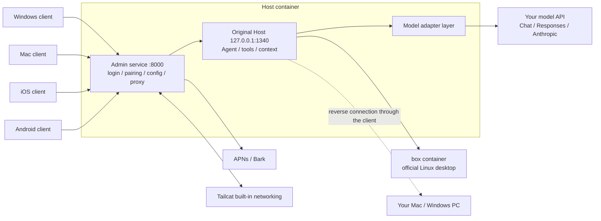

# Technical documentation

[简体中文](ARCHITECTURE.md)

This document explains how ProkBot Plus works, how each feature is implemented, and what this version changes on top of upstream ProkBot. It also covers the directory layout, tests, where to start for further development, and known limitations. For deployment steps, see the [AI deployment guide](AI-INSTALL.en.md).

## How it works

The original Grok Bot runs its server side in the official cloud, in two parts: the Host handles conversations, schedules Agents and keeps records; the cloud computer is a Linux desktop where the Agent does the actual work.

This project moves both parts to your own machines and uses the original programs directly wherever possible:

- **Host**: the original Node.js program. Only the parts tied to the official service are replaced, and an admin service layer sits in front.
- **Execution computer**: the official Linux desktop image, running unchanged in Docker. The Agent can also operate your own computer.
- **Clients**: the original interface is unchanged. The patches make them connect only to your Host.



## Maintenance map

Run `node ci/check-inputs.mjs` from the full repository to see the versions actually used by each platform and verify the inputs. Build manifests, not README badges, own versions and digests.

| Change | Start here | Verify together |
| --- | --- | --- |
| Deployment, upgrades, backups | `host/deploy.py` → `host/release/`; container startup lives in `host/deploy/supervisor.mjs` | Test fresh installs and upgrades with existing volumes separately; distinguish Host and desktop CPU architecture |
| Upstream Host or desktop | `host/recipes/host/manifest.json` and sibling recipes; ARM native dependencies are locked in `host/release/arm-runtime/` | Digest checks, patch generation, target image, startup with old volumes, actual chat and desktop |
| Server feature | `host/server/` owns admin APIs, storage and pages; `host/runtime/` owns agent and model behavior | After saving a setting in the console, verify that a client conversation actually uses it |
| Desktop or mobile update | Mac and Windows share `mac/clients/desktop/`. Android consumes the Windows extractor and recipes. iOS is independent | Each platform's `supported.json` or recipe manifest, signing and pairing. Exercise all consumers of shared code |
| Optional capability | Prefer an app or skill when possible: [app development](#app-development). Change the runtime only for Host behavior | Install, authorize, invoke and remove the capability. Never distribute upstream programs |

## Feature comparison

🟢 Original kept　🔁 Replaced with your own service　⛔ Turned off

| Feature | Original | Here | You need |
| --- | --- | --- | --- |
| 🔁 Sign-in | Official account | No account needed. The Host admin page creates a 6-character pairing code, and the client connects with the Host address and the pairing code | Nothing |
| 🔁 Host and execution computer | Official cloud | Host built for the server architecture; desktop remains original | amd64 / arm64 Linux; the amd64 desktop can be deployed separately |
| 🔁 Chat model | Official models, with automatic tier selection | Add several model services and profiles through OpenAI Chat Completions, OpenAI Responses, or Anthropic Messages. A default or per-Bot route chooses model, thinking effort, and backup order; no Jev key is needed | A model API address and API key |
| 🟢 Computer and browser use | Original Agent | Kept as is | A model with vision |
| 🟢 Memory, context compaction, scheduled tasks | Original Agent, partly relying on official services | Kept, now running on your model and local timers; context compaction is configurable | Nothing |
| 🟢 Approvals, human takeover, interactive forms | Original | Kept as is | Nothing |
| 🔁 Automatic review | Official classification service | Your model decides whether an action may run, and you can write your own allow and block rules | Nothing |
| 🔁 Teach a task | Processed by an official service | Recording is kept as in the original; your model turns the recording into a skill | A model with vision |
| 🔁 Operating your computer | Through official services | Through your Host; the computer doesn't need any open ports. Mac supports commands and graphical control; Windows supports local commands | A signed Mac client, or the Windows client |
| 🔁 Bot library, user profile | Official cloud storage and account | Stored on the Host; every device sees the same data | Nothing |
| 🔁 Skills | Official skill catalog | The Host's own skill catalog, with versions, diffs and restore | Nothing |
| 🔁 Connected apps | Official app marketplace | The Host's own app catalog. You can import code apps, remote MCP servers or skill-only apps, with OAuth and API key authorization. Bots can also write apps themselves | Each app's own credentials |
| 🔁 Complex coding | Official cloud coding Agent | Handed to Codex on a connected Mac or Windows PC, using that computer's Codex sign-in and models | A computer with Codex CLI installed and signed in |
| 🔁 Sharing Bots and skills | Official publishing platform | Publish to your own Host, export as ZIP, and import on another Host | Nothing |
| 🔁 Bots working together | Official service | Hand a task to a Bot on another Host; the result comes back to your conversation | Another Host |
| 🔁 Voice input | Official transcription | Fish Audio, an OpenAI-compatible transcription service, or a local model on a Mac | A key for the transcription service, or a local model |
| 🔁 Live calls | Official realtime voice model | Recognition and synthesis each use a service you choose (experimental) | Recognition and synthesis services |
| 🔁 Image and video generation | Official service | OpenAI-compatible image APIs (with set aspect ratios and editing from reference images), WaveSpeed and others | Provider keys |
| 🔁 Web search | Official search | The built-in web access of Claude or OpenAI Responses models, or a separately configured DeepSeek or HTTP JSON search service | Optional |
| 🔁 Push notifications | Official push | iOS: APNs when the app is signed with the push entitlement, otherwise Bark. Android: the app keeps its own connection to the Host | For iOS, the Bark app, or an Apple Developer account and an APNs key (.p8) |
| 🔁 Access from outside your network | Connects directly to the official cloud | IP address, Tailscale, an HTTPS reverse proxy, or the built-in Tailcat | A domain, depending on the setup |
| ⛔ Telemetry and error reports | Sent to the vendor | Turned off | Nothing |
| ⛔ Automatic updates | Official updates | Turned off; patches are pinned to the supported versions | Nothing |

These original features are not available at the moment: virtual cards, external message drafts, product feedback and passkey forwarding.

Upstream ProkBot also added these features, which the original doesn't have:

| Feature | Description |
| --- | --- |
| **Apps** | One JSON file is one app. It can include code, a remote MCP server or skills. Code apps run on the execution computer. Bots can also write apps themselves with the built-in "Write an app" tool. See [App development](#app-development) |
| **Webhooks** | An external system sends a signed request, and a Bot starts working on a task |
| **Usage statistics** | How many tokens were used each day, shown in the admin page and in the iOS settings |
| **Prompt management** | Edit the system prompt and restore the original at any time, and see the prompts and tools each role actually receives |
| **Per-model context settings** | Set the capacity of each model and when summarization starts, separately for each model |
| **Admin web page** | All settings are made in the browser. Supports Chinese and English, light and dark themes, and phone screens |
| **Split deployment** | The Host and execution computer can run on different machines; see [split deployment](AI-INSTALL.en.md#split-host) |
| **Backup and restore** | Archive the managed data volumes and checksum manifest for recovery into a fresh project. Docker images, the instance `.env` and the host OS are not included. See [volume backup and recovery](AI-INSTALL.en.md#volume-recovery) |

## How each part is implemented

### Patching

The patch tools copy bytes from the original files you provide (or that are downloaded automatically), add this project's changes, and produce new clients or images. Patches have only two kinds of operation, "copy" and "insert", and every segment checks the hash of the original file. Nothing is decompiled, and the original programs are not rewritten.

### Host and admin service

The original Host is a Node.js program. This project replaces only the four parts tied to the official service: authentication, Agent identity, model calls and MCP configuration. Scheduled tasks in the original are triggered by the official backend, so local timers are added here. In front of the original Host sits the admin service. It handles administrator login, device pairing, all settings and push notifications, and forwards client requests to the original Host.

- **`host` container**: the admin service listens on 8000, mapped to `${GROKBOT_LISTEN_ADDRESS:-127.0.0.1}:${GROKBOT_PUBLIC_PORT:-18080}` on the host machine. The original Host listens only on `127.0.0.1:1340` inside the container.
- **`box` container**: the official Linux desktop. Its VNC port is visible only inside the container network.

| Data | Contents |
| --- | --- |
| Volume `host-data` (`/data`) | Administrator (`auth.json`), devices, Bots, chat history, usage statistics, all settings. The model key is in `model.env`, web settings in `web-services.json`, image settings in `media.json` |
| `/data/setup-key` | Setup code. Deleted automatically after setup |
| Volumes `box-home`, `box-workspace` | Home directory and workspace of the execution computer |

| `.env` variable | Description |
| --- | --- |
| `GROKBOT_LISTEN_ADDRESS` | Address the port binds to. Default `127.0.0.1` |
| `GROKBOT_PUBLIC_PORT` | Port on the host machine. Default `18080` |
| `GROKBOT_PUBLIC_URL` | Public address. Clients check that the address matches when they pair, and the admin API checks Origin against it. It can only be a whole domain or IP, with no path |
| `TZ` | Time zone. Affects scheduled tasks and usage statistics |

Security measures for the admin API:

- The administrator password is stored as a scrypt hash (12–128 characters). After login, a cookie session is used;
- Non-GET requests must include `x-grokbot-csrf: 1`. If `Origin` is sent, it must match the public address;
- Login, setup and model tests are rate-limited per IP, 5 times per minute;
- Pairing codes have 6 characters, are valid for 5 minutes and can be used once. After pairing, each device gets its own token, which can be revoked in the admin page.

The command-line admin tool `host/tools/host-admin.mjs` (new in this version) wraps the common admin API calls: setup, listing models, configuring and testing a model, creating pairing codes, and checking status.

### Model adapter layer

The original sends model requests to an official classifier, which decides which model to use. This project takes over before the Host sends the request: it converts the messages of the original Harness into one of the three APIs, then converts the streamed reply back into the original format. Tool calls, sub-Agents and context management are still the original logic. Upstream supports only OpenAI Chat. **The Responses and Anthropic formats are new in this version.**

| File | Role |
| --- | --- |
| `host/runtime/model-session.mjs` | Entry point. Dispatches by `apiFormat` (`openai` / `openai-responses` / `anthropic`) |
| `host/runtime/model-routing.mjs` | Validates multi-service/profile configuration and resolves default or Bot override routes with backup chains |
| `host/runtime/openai-chat.mjs` | Chat Completions. Appends `/chat/completions` to the address |
| `host/runtime/openai-responses.mjs` | Responses. Appends `/responses` to the address. Stateless calls |
| `host/runtime/anthropic-messages.mjs` | Messages. The address can be the root address or end in `/v1` |
| `host/runtime/model-common.mjs` | SSE parsing, error normalization, image and file conversion, reasoning source tags, optional parameter fallback |
| `host/runtime/model-policy.mjs` | Thinking effort levels and the reference table of levels for each model |
| `host/runtime/model-router.mjs` | Chooses a Bot route directly for multi-service configuration; legacy configuration can still be manual or use Jev by task difficulty |
| `host/server/models.mjs` | Saves multi-service/profile/route configuration, reads model lists, and runs connection tests (on the same code path as real conversations) |

| Capability | OpenAI Chat | OpenAI Responses | Anthropic Messages |
| --- | --- | --- | --- |
| Thinking effort | `reasoning_effort`; DeepSeek also gets a `thinking` switch | `reasoning.effort`, with reasoning summaries and encrypted reasoning | From Claude 4.6, adaptive thinking plus `output_config.effort`; older models use a thinking budget; on models where thinking can't be turned off, `none` becomes `low` |
| Reasoning across turns | Sends back `reasoning_content` from the same model | `store: false`, sends back encrypted reasoning | Sends back signed thinking blocks |
| Images and files | Images, PDF, text files | Images directly in tool results, PDF | Images directly in tool results, PDF and text documents |
| Output limit | Chooses between `max_completion_tokens` and `max_tokens` automatically | `max_output_tokens` | Per-model limit |

- **Thinking effort**: the levels are `none`, `minimal`, `low`, `medium`, `high`, `xhigh`, `max`, and `default` (no effort parameter is sent). For the levels a model supports, the values returned by the API's `/models` come first. If there are none, the built-in reference table is used.
- **Multiple services and Bot routes**: a model service holds its API format, address, and key; a model profile binds a service, model ID, supported reasoning efforts, and context policy. The default route applies to Bots without an override, and one Bot can define a primary profile plus up to eight backups in order. This direct routing does not call Jev; a subagent inherits its parent Bot's `agentId` and therefore the same Bot route. Keys stay in private `model.env`, and the Host network boundary admits every configured model-service host only.
- **Primary/backup switching**: before the primary has emitted text or a tool call, 402, 408, 429, 5xx, network errors, and upstream-I/O-idle timeouts move to the next backup; already-streamed reasoning may still switch. The Host I/O deadline is 300 seconds by default and runs only while waiting for HTTP/SSE I/O. The Harness also has a 150-second first-token stall deadline, so most first-token stalls end through that path first. A 400, authentication/configuration error, or caller-owned cancellation/timeout does not trigger a Host switch. Explicit API-key quota exhaustion is non-retryable. A backup sharing the same key is skipped only for quota exhaustion; a 503, network error or timeout may still try another model under that key. Once a backup takes over, later steps in the same tool loop stay on it. After text or a tool call, it never switches, avoiding duplicate user-visible output and tool side effects; fallback events are written to the model routing log.
- **Reasoning source tags**: reasoning from one API format or provider cannot be read by another. Each piece records its format and provider ID. Anthropic signed thinking is also checked against the provider, but a date-qualified model snapshot or a gateway-rewritten model name is not treated as incompatible. Encrypted reasoning without a summary and empty thinking blocks are saved as `redacted-reasoning` and restored on replay.
- **Context capacity**: context and summary thresholds are imported only when a provider catalog supplies the capacity. An unknown model is `0`; the Host does not guess a context window and does not enable automatic compaction from invented values. A non-zero capacity and summary threshold set by an administrator enables Harness automatic summarization, so an older single-model `model.env` that already sets both values will start compacting at that threshold after upgrade; this is a behavior change.
- **Optional parameter fallback**: when a provider rejects an optional parameter with a 400 (for example `reasoning.summary`, `max_tokens`, `fallbacks`), the parameter is removed and the request is retried once. This is remembered for the rest of the session, and `[model] … retrying without …` is printed in the log. Replayed reasoning that is no longer valid is handled the same way.
- **Known gateway issue**: some aggregator gateways return `native_thinking_replay_mismatch` for any request with tools when they forward Claude in the Responses format. This is a gateway problem. Use the Anthropic format for Claude.

The three model adapters hand off tools only after a completed stream; premature EOF, invalid encoding, duplicate call IDs and cancellation fail the turn.

### Automatic review

When the Bot wants to do something risky on the execution computer or your computer, the original first asks the official classification service. Here the model you configured decides instead, using the original classification prompt and result format (`host/runtime/host-auto-review.mjs`). All three API formats are supported.

This version adds two things:

- The model sometimes doesn't answer as required (it doesn't call the classification tool, the JSON is incomplete, or a field is invalid). In that case the request is retried once automatically, and the action is rejected only if the retry also fails. Provider errors and cancellations are not retried.
- Every failure writes a line `Local auto-review failed: <reason>` to the Host log. In the original, failures were silent.

### Web access and image generation

The original `WebSearch`, `WebFetch` and `GenerateImage` tools are served by the Host. If no provider is configured, they don't appear.

| File | Role |
| --- | --- |
| `host/runtime/web-services.mjs` | Web adapters: `anthropic-tools` (the model's own `web_search` / `web_fetch`), `responses-search` (`web_search` in Responses, search only), `deepseek-tools`, `http-json` |
| `host/server/media-providers.mjs` | Image adapters: `openai-images`, `wavespeed`, `http-json`. `mediaInput` converts tool arguments into the request body |
| `host/runtime/media-services.mjs` | Records generation tasks, saves results to disk, prevents duplicate submissions |

Changes in this version:

- **Newer Claude models can use the web too**: Claude with thinking turned on doesn't accept forced tool calls. When `anthropic-tools` gets this kind of 400, it switches to automatic tool choice, asks for the tool call in the prompt, and remembers this choice for that model.
- **Tolerant parallel search**: Claude often sends two searches at once, and the one over the usage limit returns `max_uses_exceeded`. The old logic marked the whole search as failed because of this. Now the result is used as long as one search succeeds.
- **Aspect ratio converted to size**: the original tool passes `aspect_ratio`, but the OpenAI image API only accepts `size`. The Host picks the entry with the closest ratio from the `size` list in the model's parameter definition. Without a list, it uses `1024x1024`, `1536x1024`, `1024x1536`. When the Bot sets `parameters.size` explicitly, that size is used.
- **Editing from a reference image**: when `openai-images` gets a reference image, it sends a multipart request to `/images/edits` instead (field name `image[]`).

The parameter definition of an image model is an optional advanced setting, written in `models[].inputSchema` of `PUT /admin/api/media`. Without it, ratios are converted to the three standard sizes, and reference images are still accepted:

```json
{
  "id": "gpt-image-2", "providerId": "images", "model": "gpt-image-2", "kind": "image", "enabled": true,
  "name": "GPT Image 2", "description": "Text-to-image and editing from reference images. Use high quality when high detail is needed.",
  "parameters": { "size": "1024x1024", "quality": "high" },
  "inputSchema": { "type": "object", "additionalProperties": false, "properties": {
    "prompt": { "type": "string" },
    "images": { "type": "array", "items": { "type": "string" }, "maxItems": 10 },
    "size": { "type": "string", "enum": ["auto", "1024x1024", "1536x1024", "1024x1536", "1536x1152", "1152x1536", "1536x864", "864x1536"] },
    "quality": { "type": "string", "enum": ["auto", "low", "medium", "high"] }
  } }
}
```

- With a parameter definition, only models with an `images` property receive reference images. Don't add it for a model whose API doesn't support editing.
- The `size` list needs both landscape and portrait sizes, so the ratio conversion has something to choose from.
- Addresses for web and image providers always end in `/v1`, including `anthropic-tools`. This is different from the root address used for the Anthropic chat model.

### Delivery order of multiple messages

The original prompt asks the Bot to reply the way people text: first one sentence to acknowledge, then the conclusion and extra details split across 2–4 `SendToUser` messages. The original model output is streamed, and each tool call runs as soon as it has been written, so the messages naturally arrive in order.

The model layer in this project waits until the whole reply has finished, then hands all the tool calls to the Harness at once. This way a retry after a mid-stream error doesn't run tools twice. But the reliability layer `host/runtime/reliability/tool-journal.mjs` writes the execution intent to disk before it runs each tool, so when several messages start at the same time, whichever finishes writing first is sent first.

`host/runtime/reliability/tool-order.mjs` (new in this version) records the order in which `SendToUser` / `SendToAgent` were written in each reply, and makes each message wait until the previous one has run before it starts. Other tools still run in parallel. If the previous message never runs, it waits at most 15 seconds. On cancel, it stops waiting right away.

If the previous step contained only one plain-text `SendToUser` call and the immediately following Host receipt confirms success, a new model response that requests only the exact same text stops with a non-retryable error before delivery. The original message and model usage are retained. This check does not cross user turns, remove historical rows, or infer delivery for attachments, multi-tool steps, or missing or unsuccessful receipts.

### Execution computer

In the original, every user gets an official cloud computer. Here the same official Linux desktop image runs in your Docker, and the Host operates it over an authenticated connection. The execution computer can be on the same machine as the Host or on another one. When you want the Agent to operate your own computer, the client connects out to the Host, so your computer doesn't need any open ports.

### Mac client

The original Mac client is an Electron app. Here the original interface is kept, and the main process that handles connections and system features is rewritten (`mac/clients/desktop/`, also used by the Windows version) so that it connects only to your Host. Complex coding tasks go to Codex on this Mac, using the Mac's own Codex sign-in and models.

- Ad-hoc signed by default. For the Agent to control the local graphical interface, sign it with your own certificate (`--identity auto`) and grant Accessibility and Screen Recording permissions.
- The output goes in a `.noindex` folder so Spotlight doesn't index it as a duplicate app.

### Windows client (new in this version)

`windows/patchers/desktop/patch.mjs` uses the recommended `Grok_Bot_1.1.0_Setup.exe` by default and the fallback with `--version 0.71.2`; `--source` also accepts the stock installer, `app-64.7z` or an installed folder. It extracts `app-64.7z` from NSIS with Windows 11 `tar.exe` or 7-Zip on Windows 10, verifies `resources/app.asar` and replays the recipes. `--verify-only` stops here. A client build installs the shared main process, repacks the ASAR and compares the list of unpacked files such as `.node` modules. The output copy of `Grok Bot.exe` has an updated ASAR header digest and no vendor signature. Outputs include Tailcat, a portable directory and ZIP, an installer and a `*.patch.json` manifest. The recommended release's pinned inputs are in `windows/patchers/desktop/`, and each fallback release is in a subdirectory named after its version (currently `0.71.2/`). `windowsReleases` in `inputs.mjs` lists the recommended release first, then the fallbacks from newest to oldest. A `--source` file is matched to a release by the size and SHA-256 in `supported.json`, and an installed folder by the digest of its `app.asar`. An installer that matches none is verified against the recommended release; the failure names the accepted versions, and pairing does not run.

`windows/tools/desktop-recipes/build.mjs` generates the 1.1.0 recipes. Each edit in `spec.mjs` is anchored to text that occurs exactly once in its original file. Unchanged original bytes become copy ranges, so a recipe adds only project code (appended modules live in `extensions/`). `--check` regenerates the recipes from the official installer and compares them byte for byte with the committed files. The 0.71.2 inputs and recipes are shared by the Windows fallback and the Android 0.71.2 interface. `windows/tools/port-desktop-recipes.mjs` produced those recipes: it aligns asset names, exported symbols and copy ranges between Mac and Windows builds **of the same version**, with copied bytes from the Windows original. It does not port across releases.

| Runtime | Windows behavior |
| --- | --- |
| Window, tray and notifications | `platform.mjs` uses `titleBarOverlay` for the system buttons. Closing the window leaves the app in the tray; notifications use a Start menu shortcut with an AppUserModelID. Normal startup leaves unreadable shortcuts, shortcuts targeting other apps and existing `grokbot-local:` handlers alone. Side-by-side and isolated test launches register neither; launch a side-by-side copy from its own directory. |
| Local execution | The Host sees `win32` and `win-<device ID>`. `loadLocalExecDaemon` enables PowerShell UTF-8 output for the stock executor. Starting from Git Bash rewrites arguments such as `cmd /c`; use the Start menu for a normal install. The Mac mouse and keyboard component is not available on Windows. |
| Images and Codex | `remoteAttachmentPath` treats Host image URLs such as `file:///data/...` as POSIX paths. Delegation uses the local `codex.exe` (including npm installs) and `taskkill /T` to stop the process tree. |
| 1.1.0 interface | The preload declares methods on three edges, `desktop-mount`, `main` and `spotlight`; `desktopEdges` in `local-services.mjs` registers handlers per edge, and window show and hide reach the renderer as events. `gateway.mjs` maps global search (`searchMessages` / `searchFiles`) to the Host's `searchAgents` / `searchMedia`. `dictation.mjs` buffers the renderer's 16 kHz PCM until recording stops, then sends it as WAV to the Host's `/local/audio/transcriptions`. A failed real-time voice credential reply carries `usageRefusal: null`, so the renderer does not report a usage limit. |

The Go standard-library installer in `windows/installer/` consists of `stub.exe`, the portable ZIP and a 32-byte trailer. A normal per-user install under `%LOCALAPPDATA%\Programs\Grok Bot Local` registers an uninstall entry and a Start menu shortcut. It accepts `/S` and `/D=directory`. Rebuild commands:

```sh
# Rebuild the stub from windows/installer/
go build -trimpath -ldflags="-H=windowsgui -s -w" -o ../dist/installer/grokbot-setup-stub.exe .
# Rebuild Windows Tailcat from the repository root (requires Go)
python host/network/build-tailcat.py --target windows-amd64 --output windows/dist/network
```

### Android client

The official Android app (`ai.x.grok.bot` 1.16.0) is a React Native app with Google Play tamper protection; once modified it stops working, and circumventing that protection is out of scope for this project. So the Android client does not modify the official Android app. It runs the official **desktop** interface on the phone (the same one as the Windows and Mac clients), with an Android shell written for this project in place of Electron.

**The shell** (`android/shell/`, Kotlin, no third-party libraries; `android/dist/grokbot-android-shell.apk` is its prebuilt release build) is a full-screen WebView plus:

- **A local gateway** (`LocalGateway.kt`) that listens only on `127.0.0.1`:
  - The interface port (from 39710) serves the interface files and the `/__native/*` native endpoints, and forwards `/api`, `/events`, `/local`, `/connect` and `/notifications` to the Host, adding the device token.
  - The computer view port (from 39720) forwards only the noVNC pages and WebSockets under `/vnc/desktop/` and `/vnc/fork/`.
  - Both ports check an HttpOnly, SameSite=Strict cookie generated at random on every start; the interface port also checks Host, Origin and Sec-Fetch-Site.
  - The device token stays in the native layer; the web page never sees it. When the Host fails, the gateway answers 502 instead of leaving the page an empty response.
- **The credential** (`Storage.kt`): the device token is encrypted with an AES-GCM key in the Android Keystore; settings and the interface's persisted data are kept in the app's private storage.
- **Notifications** (`Notifications.kt`): a foreground service follows the Host's `/notifications/events` (the same stream the iOS client reads), removes duplicates by creation time and stays quiet for the Bot being viewed. Tapping a notification opens that Bot through `grokbot-local://agent/<id>`. It resumes after a reboot or an update, and asks to pair again when the device is revoked. Notification texts follow the language chosen in the app.
- **System features**: file picking, the system save dialog, microphone permission, the back gesture, dark mode and system bar colors, screen insets.

**The bridge** (`android/client/`) replaces Electron's main process and preloads inside the WebView:

- `bridge.js` emulates `ipcRenderer`, `contextBridge` and `process` and runs the original `preload.cjs` unchanged.
- `services.js` and `gateway.js` port the local methods of the desktop client's main process (`mac/clients/desktop/`): chunked attachment uploads, saving files, profile, voice, settings, connected apps and more.
- `webview.js` replaces Electron's `<webview>` with an iframe:
  - The gateway forwards the computer view page from the Host and injects `vnc-bridge.js` and the original `preload-vnc.cjs` from the noVNC page's own folder (code that the original preload passes to `executeJavaScript` imports noVNC modules by page-relative paths).
  - `executeJavaScript`, `send`, `insertCSS` and `ipc-message` work over postMessage and accept only the app's own interface.
  - The iframe follows the `pointer-events` set by the interface, so the Bot's computer takes touch and on-screen keyboard input only after "Take control".
  - The desktop clients use a reduced VNC preload; the original one used here also gives the phone an input method field, the clipboard and adaptive quality.
  - The computer view address carries a Host ticket that expires after 10 minutes. On a phone the 1.1.0 interface keeps the address it read first, so before each noVNC page load `webview.js` rereads the Bot's `getForeverBoxStatus` through `gateway.js` and swaps in the current ticket; on an error or timeout it keeps the original address.
- `layout.js` and `android.css` lay the interface out after the official phone app, with colors, sizes and the typeface taken from its design values:
  - Below a window width of 600 px, the Bot list and a conversation are two full-screen pages. `layout.js` picks the page from taps on a Bot, search, creating or deleting a Bot, new group chats and notifications, adds a back button to the conversation, and the back gesture in a conversation returns to the list. After "Create" it waits for the Host to make the Bot, then opens its conversation.
  - Back, the account, search, new Bot and add are round floating buttons, and the conversation shows the Bot's name in a pill at the top; bubbles, the message field, list rows and sheets have the official app's sizes and colors; the typeface is XVF, which the desktop interface ships.
  - The list has no marketplace button; `layout.js` adds a marketplace entry to the account menu. It also formats the last-active time on each row (the time today, then "Yesterday", the weekday and the date).
  - Conversation details, settings, the marketplace and search fill the screen; other dialogs, menus and choices slide up from the bottom; images and the large computer view are full screen on black.
  - From 600 px up the desktop layout stays; below 792 px conversation details are a full-screen layer that steps aside for the large computer view.
  - Settings that mean nothing on Android (hardware acceleration, local access, Tailcat) are hidden; wide images are scaled to the column.
  - The 1.1.0 interface marks dialogs and menus with `data-component` attributes (such as `base-dialog-popup` and `menu-popup`) and `sand-` prefixed classes, while 0.71.2 uses classes such as `.ui-dialog`; the `android.css` selectors match both.
- `anchor-fallback.js`: WebView builds before Chromium 125 lack CSS anchor positioning, and the computer view collapses to nothing. The fallback records anchor names and position expressions and turns them into pixels after layout.
- `compat.js`: a classic script in ES5 syntax that runs before the interface and the pairing page.
  - The official interface calls built-ins newer than the WebView without checking for them, for example `URL.canParse` (Chromium 120), `toSorted` (110), `Object.hasOwn` (93) and `showPopover` (114); the 1.1.0 interface also uses `moveBefore` (133, which falls back to `insertBefore`). An older WebView parses the page, rendering throws, and React unmounts the whole tree, leaving a blank page. `compat.js` only adds missing functions and never replaces existing ones.
  - If a page does not start (below Chromium 89, because the pairing page uses top-level `await`), it shows the WebView version, the error and what to update instead of a blank page.

**The builder** (`android/patchers/patch.mjs`):

1. Downloads and verifies the official Windows installer, extracts `app.asar` and applies that release's Windows recipes (the same ones as the Windows client). The recommended 1.1.0 is the default; `--version 0.71.2`, or a 0.71.2 installer given with `--source`, selects 0.71.2. The top level of `supported.json` is the recommended release and `fallback` lists the others, each pinning its interface entry and preload digests; `rendererVersion` in the build record says which one was used.
2. Verifies the SHA-256 of the interface entry, `preload.cjs` and `preload-vnc.cjs`, then applies that release's interface changes in `renderer-patches.mjs`; each file is verified by hash first and every anchor must be unique:
   - The window width check for conversation details is relaxed (a phone cannot widen its window).
   - The "Teach a task" and "Get the mobile app" entries are removed.
   - The computer view's anchor styles get custom properties that the fallback reads.
   - Each row of the Bot list shows when the Bot was last active.
3. Puts the interface, the bridge, the original preloads (wrapped as an ES module and a plain script) and the official icon into `assets/web/` of the shell APK.
4. Aligns the entries as zipalign does and signs the APK with signature scheme v2 (`apk.mjs`, plain Node.js). The signing key is created on the first build and kept in `~/.grokbot-local/android-signing.json`.

**Pairing**: Android sends `platform: desktop` with `clientKind: android`. Updated Hosts store new pairings as Android devices without desktop execution privileges; older Hosts ignore the extra field and remain compatible. Full-width characters typed by Chinese input methods are converted first.

**Differences from the desktop clients**: no Tailcat; the Bot cannot run commands on or operate the phone (`getLocalToolPermission` answers `never`); no "Teach a task".

### iOS client

The original iOS client is built with React Native. Here an injected dynamic library (Objective-C, source in `ios/clients/ios/`, compiled with `build.py`) sends the requests meant for the official service to your Host, and a few fixed changes are made to the Hermes bytecode. The three extensions (widgets, share and notifications) are kept, each with its own bundle ID. The patch outputs an unsigned IPA, and you sign the main app and all three extensions yourself (see [client installation and signing](AI-INSTALL.en.md#client-packages)).

The iOS bytecode patches (`ios/recipes/ios/*.hbc.gbp.gz`) are data generated by the upstream author: the patch content is fully public, but the process used to modify the bytecode is not included in the upstream repository.

### Voice

Live calls in the original use an official realtime voice model. Here the original call screen, microphone and playback logic are kept, and the conversation is split into three steps: a recognition service turns your speech into text, the current Bot answers with its own model, context and tools, and a synthesis service reads the answer aloud.

### Push notifications and access from outside your network

The Host can send notifications directly through the Apple Push Notification service (APNs). This needs an Apple Developer account with push capability and a .p8 key. Without one, use Bark.

You can reach the Host only on the LAN, through a VPN, or through an HTTPS reverse proxy. The easiest option is the built-in Tailcat. Tailcat is based on Tailscale's open-source networking component and is built into the clients, the Host and the execution computer. Copy the connection link or scan the QR code to connect; no Tailscale sign-in is needed.

<a id="app-development"></a>
### Skills, apps, sharing and collaboration

In the original, the skill catalog, the app marketplace, Bot template publishing and multi-Agent collaboration all depend on the official platform. Here each one has its own version on the Host, keeping the original interface wherever possible: the app marketplace list, the skill publishing menu and the Bot publishing card are all original screens, with the data coming from your Host. Code apps and webhooks are new, and they are connected to the original tools and automated tasks.

To develop an app, declare code, remote MCP or skills in a `grokbot-app` JSON package, then import and authorize it in the console. Code apps run on the execution computer with that user's file and network access. The full format and OAuth examples are in `host/server/application-guide.md` in the Host package, the same guide a Bot reads when it writes an app.

## Directory layout and key files

| Path | Contents |
| --- | --- |
| `host/deploy.py` | Operator entry point: instance selection, checks, initialization, backup before upgrade and status. Distinct from the in-container `host/deploy/` |
| `host/release/` | `build-docker.py` downloads and verifies the originals and builds `grokbot-host:local`; `patch-host.py` and `bytepatch.py` apply the Host patches; `compose*.yaml` for deployment; `backup.py` for backup and restore; `Dockerfile.*` |
| `host/server/` | Admin service: authentication, pairing, push, all settings, admin web page (`public/`) |
| `host/runtime/` | Runtime injected into the original Host: model adapter layer, web and images, automatic review, reliability layer (`reliability/`) |
| `host/deploy/` | Process management inside the container, standalone execution node |
| `host/tools/host-admin.mjs` | Command-line admin tool |
| `host/network/` | Go source and build script for Tailcat; `host/bin/` holds the prebuilt Linux version |
| `host/tests/` | Server unit tests |
| `mac/clients/desktop/` | Desktop client main process, shared by Mac and Windows: connection, pairing, notifications, attachments (`attachments.mjs`, `attachment-uploads.mjs`), external links and previews, local commands (`local-exec.mjs`), Codex delegation, dictation (`dictation.mjs`). Platform differences are kept in `platform.mjs`. The `*-settings-extension.js` files are the source of the code the 0.71.2 recipes add to the original settings pages; changes to them take effect only after the recipes are made again. The Windows 1.1.0 equivalents are in `windows/tools/desktop-recipes/extensions/`. The Android client also copies `i18n.mjs`, `external-url.mjs` and `connectors.mjs` from here |
| `mac/patchers/desktop/` | Mac patcher, recipe applier and original-app downloader (`download-original.mjs`). The Windows patcher uses it too |
| `windows/patchers/desktop/` | Windows patcher: `patch.mjs`, `original.mjs` (extracting the official installer, also used by Android), `pe.mjs` (icon, ASAR integrity, signature table), `zip.mjs`, `recipes/`; `0.71.2/` holds the fallback release's inputs and recipes (shared by the Windows fallback and Android), and `inputs.mjs` lists the releases and recognizes an input by its digest |
| `windows/tools/desktop-recipes/` | 1.1.0 recipe generator: `build.mjs`, the anchored edit list `spec.mjs`, and the project code appended to original modules in `extensions/` |
| `windows/tools/`, `windows/installer/`, `windows/dist/` | Same-version recipe porting tool, installer source, prebuilt Tailcat and installer stub |
| `android/shell/` | Android shell (Kotlin): local gateway, credential, pairing, notifications, files and the back gesture; `release-shell.mjs` builds `android/dist/grokbot-android-shell.apk` |
| `android/client/` | Bridge in the WebView: replaces Electron's main process and preloads, computer view, layout adjustments, anchor fallback, connection page |
| `android/patchers/` | Android builder: `patch.mjs`, `apk.mjs` (ZIP and APK signing), `renderer-patches.mjs`, `supported.json` |
| `ios/release/` | iOS patch entry point `patch-ios.py`: verifies the user's IPA and outputs an unsigned file |
| `ios/clients/ios/` | Source of the injected library, native UI and feature adaptations (for example tunnel management in `GBNetwork.m` and voice transport in `GBVoiceSocket.m`); `audio-processing/` is the echo processing library |
| `*/recipes/` | Patch data that copies bytes from the original files and adds this project's changes |
| `*/THIRD_PARTY/` | Third-party licenses |

## Linux deployment notes

- `host/release/platforms.py` detects the **Docker daemon** architecture. `host/recipes/host/manifest.json` owns the Host, desktop and patch inputs. Both architectures share the patch pipeline. amd64 retains the original base; ARM64 uses Node 22, locked native modules and a matching Tailcat build. The original desktop always uses `linux/amd64`.
- Local ARM mode probes a small isolated amd64 container before downloading the desktop. Split mode skips emulation checks and the ARM Host skips the desktop download. The pinned manifest and config digests are accepted; offline imports verify the config digest and recheck the loaded image.
- **Historical A1 split test, not hardware acceptance for this round:** a native ARM64 Host connected to a separate amd64 desktop. Pairing, a two-turn context chat with a local test model, a 1280×800 VNC frame and pointer input passed. After switching the Host runtime used in that test, the same device could read both replies. Docker was not installed on the A1. This does not verify the current image build, Compose upgrade or the capacity of either machine.
- **Single-machine emulation remains experimental:** an Ubuntu 24.04 ARM64 VM passed both `doctor` preflights, including running an amd64 container. That is not an end-to-end test of the full desktop on a single A1.
- Code checked out or uploaded on Windows loses its executable permission. So `Dockerfile.base` and `Dockerfile.execution` run `chmod 755` after copying the Tailcat program, and the Mac patcher also makes the Tailcat in its output executable.
- Ports published by Docker don't go through ufw. To restrict access, change `GROKBOT_LISTEN_ADDRESS`, or restrict it at the network boundary.
- Containers are paused during a backup, so the health check may fail briefly. This is normal.

<a id="capacity-evidence"></a>
### Interpreting capacity evidence

The minimum (2 cores / 4 GB) and recommended (4 cores / 8 GB) configurations under [server requirements](../README.en.md#server-requirements) come from three records: both time-bounded 2C2G diagnostics failed; separate 2C4G and 4C8G VMs each deployed from scratch and completed pairing, an attachment, two real-model turns, cancellation and readback after a restart; and the author's production instance (6 cores / 12 threads, 16 GB) ran for about a week with memory peaks of 0.9 GB for the Host and 1.7 GB for the execution desktop, with about 13 GB of images. They show enough headroom for one person or a household, but none is a sustained test with overlapping clients, so the homepage gives no configuration for many users.

The ARM experiment in this round used an ARM guest emulated on x86_64: the split Host preflight and fixture volume round trip passed, but the Host image build and core startup checks did not. It was not a physical A1 test. The upstream Mac/iOS patches and historical device results are not native platform acceptance for this candidate either.

A capacity rating for many users or heavier load requires at least three baseline and three candidate rounds with matching resources and workloads, each with at least an hour of real sustained load and every failure retained. A recommendation also needs headroom under overlapping client requests. Split deployments require whole-guest observations on both machines. Model wait is not Host processing time; a healthy container, one build, process RSS or a container limit cannot establish capacity. The procedure is in the Host package or full repository: `host/README.en.md`, “Whole-machine benchmarks” (`#capacity-benchmark`). Run it only in dedicated, authorized non-production VMs; never use production services, volumes or credentials.

## Tests

```sh
node --test "host/tests/*.test.mjs"      # server
node --test "windows/tests/*.test.mjs"   # Windows client
node --test "mac/tests/*.test.mjs"       # Mac / shared client
node --test "android/tests/*.test.mjs"   # Android client
```

The network layer of the iOS injected library has one more test, which runs on a Mac with the Xcode command line tools: `python3 ios/tests/ios-network.test.py`.

Coverage:

- **Server**: request building, stream parsing, reasoning replay, parameter fallback and error classification for all three formats, plus:
  - image ratio conversion and editing from reference images;
  - web tool fallback and parallel search tolerance;
  - automatic review retries;
  - message order.
- **Windows client**: window style, installer layout, finding Codex, Host image paths, command output encoding.
- **Mac client**: attachments, external links, previews, sidebar and more.
- **iOS network layer**: starting the Tailcat tunnel (concurrent requests start it once), restoring it, rebuilding it after connection errors, and shutting it down.
- **Android client**: APK alignment, signing and tamper detection, the signing key, the interface entry and interface patches, wrapping the original preloads, Host attachment paths, computer view addresses, event stream parsing, anchor position arithmetic, image scaling, switching between the list and conversation pages on phones, the format of the last-active time.

After changing code, it's a good idea to also check it for real:

- Use `host-admin.mjs model-set --test-only` to send real requests in each format;
- Have a multi-turn conversation with tool calls in a client;
- Ask the Bot to search for a news item, read a web page, draw a 16:9 image, and then change one thing in that image.

**ARM release acceptance:** use an authorized, unused ARM64 Linux server, never production volumes. Follow the [install guide](AI-INSTALL.en.md) for a local desktop and record the Host platform, desktop mode and completed build. Pair a client, have a two-turn conversation, create a harmless file on the desktop and see it through VNC. Run `backup` and `update`; verify that both the chat and file survive. Record the machine model, cold start time and desktop responsiveness. An isolated Host core, emulator probe or model test cannot substitute for these results.

## Where to start for further development

| Task | Where |
| --- | --- |
| Add a new model API format | Create an adapter file in `host/runtime/` that implements a generator with the same shape as `openai-chat.mjs`, then register it in these places: `model-session.mjs`, `CLASSIFIERS` in `host-auto-review.mjs`, `host/server/models.mjs`, and the admin page `host/server/public/model.js` |
| Adjust the thinking levels of a model | `effortLevels` in `host/runtime/model-policy.mjs`. Claude model features are in `anthropic-messages.mjs` |
| Change the admin page | `host/server/public/`. English strings are in `locales-en.js` |
| Change the desktop client | `mac/clients/desktop/` is shared by Mac and Windows. Android packages `workspace.css` and `workspace-keys.cjs` along with the language, external-link and connector modules; all three clients use the same table and dialog-key behavior |
| Change the Android client | The bridge is in `android/client/`; the shell is in `android/shell/`. After changing the shell, run `node android/shell/release-shell.mjs` to update the prebuilt shell and its digest (needs JDK 17+ and the Android SDK) |
| Support a new official client version | Windows: to keep the current release as a fallback, first move its inputs and recipes to `windows/patchers/desktop/<version>/`. Update `supported.json`, adjust the anchors in `windows/tools/desktop-recipes/spec.mjs` to the new originals and run `build.mjs`, then follow [desktop compatibility](#desktop-compatibility) for acceptance. For Android, also verify the WebView bridge and `renderer-patches.mjs` before updating `android/patchers/supported.json` (the older release moves into `fallback`) |
| App (plugin) development | [App format and runtime](#app-development); the full development guide is in the Host package |

<a id="desktop-compatibility"></a>
### Desktop versions and compatibility

Windows x64 recommends **1.1.0** and falls back to **0.71.2**; Android's desktop renderer also recommends 1.1.0 with a 0.71.2 fallback; Mac ARM64 remains at **0.71.2**. The Android shell has its own [version](../README.en.md#client-versions). On November 14, 2026, the [Windows](https://api2.cursor.sh/updates/api/download/stable/win32-x64-user/sand) and [Mac](https://api2.cursor.sh/updates/api/download/stable/darwin-arm64/sand) feeds reported **1.1.0**. In the [dated snapshot](https://github.com/ferretgeek/prokbot-plus/blob/a868918f4e2f64ab6529b3afaf92dd6019235efe/ci/official-snapshot.json), `build` is a build ID. `observedArchiveSha256` and `observedAsarSha256` are the measured SHA-256 digests of the whole EXE/DMG and its ASAR, respectively; neither is a production pin. The [official changelog](https://x.ai/changelog/bot) stopped at **1.0.1** that day and attributed no features to 1.0.3 or 1.1.0.

For 1.0.3, each platform lost 10 of 16 legacy recipe source paths; all six remaining files changed. Both preloads also differed from 1.0.1. The full installer digests were measured separately:

| 1.0.3 input | Bytes | Full installer SHA-256 | Verification |
| --- | ---: | --- | --- |
| Windows x64 EXE | 127,368,160 | `183bbc6752e80163f4eb7a729ba4326884d4554957337872509b426a1d856729` | Valid Anysphere Authenticode signature |
| Mac ARM64 DMG | 158,410,960 | `802e852fadb20308f83166ee13dd0c20d3e0978f982505353925dbd4b535bdd9` | Version and bundle ID checked; no Mac signature check or launch |

`windows/tools/desktop-recipes/` generates the 17 Windows 1.1.0 recipes from the official installer. The renderer handshake is still v3; the preload now declares RPC methods per edge, and the main process registers handlers per edge (see [Windows client](#windows-client-new-in-this-version)). On November 16, 2026, a portable build produced by the patcher was connected to a self-hosted Host on Windows 11. Verified: pairing (including refusal when the Host returns a different address), a two-turn chat, global search, an attachment upload read back by the Bot, local command approval and execution, a restart after a forced exit with history read back, and notification decisions (no alert while the window has focus, delivery with a sound once minimized). Started on a 0.71.2 client's profile, 1.1.0 read back the conversations, the selected Bot and the panel layout without pairing again. When a local mock Host dropped every connection, gained a new reply while down and came back, the client reopened its event streams within about 7 seconds and reread the conversation; the new reply appeared once. Dictation audio reached the Host, but the test Host has no speech recognition configured. Real-time voice was verified only against a local mock relay. The same day, the patched Windows 0.71.2 fallback paired with the same Host and chatted. The Android 1.1.0 interface was verified on an Android 15 emulator (WebView 124): pairing, chat, images, search, the Chinese interface, dark mode, notifications, the back gesture and the Bot computer view (including reopening it after its ticket expired); with newer built-ins removed to simulate an older WebView, it still started. The Android 0.71.2 interface passed a smoke test of chat and the computer view. The Mac 1.1.0 original needs its own digests and recipes and is not supported yet. The [vendor deployment guide](https://docs.x.ai/grok-bot/deployment) does not map desktop versions to Host or execution-image digests; [private-network routing](https://docs.x.ai/grok-bot/private-networks) does not select a chat server.

<a id="desktop-protocol"></a>
#### Shared desktop protocol

| Boundary | Behavior |
| --- | --- |
| Electron preload to main process | RPC probes in `main.mjs` and `local-services.mjs` require the trusted window's main frame, a declared method and an installed callable handler. Check the synchronous boot snapshot, call arguments, success and failure replies, and event subscription and removal. Method names alone cannot establish compatibility. |
| Renderer to Host gateway | `gateway.mjs` sends v3 `ready` once per port and closes a port on an explicit version mismatch. In-flight IDs are deduplicated per port; cancellation affects only that request, and closing the port discards late replies. Client cancellation cannot undo a command the Host has processed. |
| Pairing, events and settings | `connection.mjs` encrypts the device credential and retries only the saved Host origin or Tailcat tunnel. Changing the endpoint requires fresh pairing; requests reject redirects. `streams.mjs` reports online only after `/events` returns HTTP 200 with a body and `text/event-stream`. It notifies the renderer on disconnect, reconnects with `Last-Event-ID`, and handles 401 as loss of device authorization. `client-persistence.mjs` keeps the previous settings if a write fails. |

<a id="desktop-validation"></a>
#### Version checks and tests

From the repository root:

```sh
node ci/check-inputs.mjs
node ci/official-channels.mjs --online --phase planning
node ci/official-channels.mjs --online --phase pre-release
node ci/desktop-source-audit.mjs <windows|mac> <app.asar> 1.1.0 <asar-sha256>
node windows/tools/desktop-recipes/build.mjs --source <Grok_Bot_1.1.0_Setup.exe> --check
node --expose-internals windows/tools/inspect-desktop-preload.mjs <preload.cjs> <preload-sha256>
node --test windows/tools/inspect-desktop-preload.test.mjs
```

Channel checks read public metadata. Supply an independently verified SHA-256 for each ASAR or preload. The preload inspector parses syntax without executing code and can miss dynamic channels. When updating the snapshot, check the iOS store and bundle IDs and read Android `versionName` / `versionCode` from the compiled `AndroidManifest.xml`. Run `node ci/homepage-versions.mjs --write` and `node ci/homepage-versions.mjs` to update and verify both READMEs without changing the pins.

1. Verify the original signature, renderer imports through to their callers, and native dependencies separately on each platform; retain the stock entry's CSP and update policy. Bind each candidate recipe to its source and target SHA-256, replay the stock and staged behavior, and check that incorrect inputs are rejected.
2. Check ownership and links for public, unlisted, team and Host-local catalog entries, empty/loading/search states in both languages, file and transcript tables, drafts during Bot creation, dialog focus and IME, and playback speed after reopening. Bot library selection and labels must match the Host limits: 20 MiB per file, 100 files, 100 MiB total. Chat uploads and files already on the Bot computer are separate paths.
3. On each native client, test pairing, rejection and revocation, the Bot list and history, two chat turns, cancellation, attachment upload and readback, reconnect without duplicates and history after restart. Only then update `supported.json` / `manifest.json`, recheck the pinned inputs and run the four suites. Host changes also require an image rebuild on the target architecture.

<a id="host-patch-measurement"></a>
### Same-disk Host patch measurements

On November 13, 2026, the baseline and candidate used the same WSL2 ext4 filesystem, Python interpreter, pinned input archive and recipes. The candidate streams archive verification and reuses each source digest while checking every output. The cold and warm conditions apply to the input file pages. Earlier samples from different mounts are excluded. Each version and page condition had eight timed runs (32 total); two additional warm-ups were excluded from the medians.

| Input file pages | Median wall time: baseline → candidate (s) | Median peak RSS of patch child: baseline → candidate (KiB) |
| --- | ---: | ---: |
| Cold | 5.937 → 1.269 | 97,470 → 47,268 |
| Warm | 6.390 → 1.557 | 97,394 → 47,208 |

Every run produced the same 294 paths, sizes and SHA-256 digests. Across 34 runs including warm-ups, all 9,996 per-file hash checks passed. Wall time covers Python startup, local archive verification, unpacking, patching and output, not downloads, Docker image builds or inference. Cold input pages are not a cold machine, and child RSS is not whole-machine memory. These measurements do not establish capacity or production performance; see [interpreting capacity evidence](#capacity-evidence).

## Known limitations and to-do

- Only the versions pinned in the build manifests are supported. When the official apps update, the patches must be updated too. There are no automatic updates.
- Windows client:
  - Can't yet let the Bot control the mouse and keyboard;
  - Not code-signed, so SmartScreen shows a warning on first launch;
  - x64 only;
  - Tailcat and live voice have not been tested against a real Host yet.
- Android client:
  - No Tailcat.
  - The layout follows the official phone app, but the pages are the desktop ones: settings are tabs such as General, Computer and Updates, the marketplace has the desktop categories and content, and the conversation has no computer button at the top right as in the official phone app (the Bot's computer opens from the conversation details).
  - Background notifications rely on a foreground service; some vendor systems require allowing the app to run in the background.
  - Voice input and live calls are verified only up to the request reaching the Host; they have not been tested against a real voice service.
  - Historical checks covered an Android 15 emulator (WebView 124) and pairing, notification permission and layout on Android 16 (WebView 134). This round's Android 15 emulator paired, read existing history and received two real model replies, but duplicate text was persisted. The full conversation flow after the fix remains unverified. The attachment check reached the system picker, not a completed upload. No physical Android device result is available.
- The original desktop is amd64 only. Full deployment and performance with the Host and emulated desktop on the same A1 have not been verified.
- iOS needs your own decrypted IPA and signing certificate. Headphones, Bluetooth and network switching have not been fully tested on real devices.
