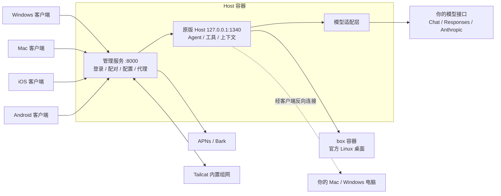

# 技术文档

[English](ARCHITECTURE.en.md)

这份文档说明 ProkBot Plus 的原理、每个功能是怎么实现的、本版本在上游 ProkBot 之上改了什么，以及目录、测试、二次开发入口和已知限制。部署步骤见 [AI 部署手册](AI-INSTALL.md)。

## 原理

原版 Grok Bot 的服务端在官方云端，分两部分：Host 负责对话、调度 Agent 和保存记录；云电脑是一台 Linux 桌面，Agent 在上面实际操作。

这个项目把两部分都搬到你自己的机器上，尽量直接使用原版程序：

- **Host**：原版 Node.js 程序，只替换和官方服务绑定的部分，外面再加一层管理服务。
- **执行电脑**：官方 Linux 桌面镜像，原样运行在 Docker 里。也可以让 Agent 操作你自己的电脑。
- **客户端**：原版界面不变，补丁让它只连接你的 Host。



## 维护地图

在完整仓库运行 `node ci/check-inputs.mjs` 查看各平台实际使用的版本并核对输入。版本和摘要由构建工具读取的清单决定，不以 README 徽章为准。

| 想改什么 | 从哪里开始 | 必须一起验证什么 |
| --- | --- | --- |
| 部署方式、升级、备份 | `host/deploy.py` → `host/release/`；容器内启动在 `host/deploy/supervisor.mjs` | 新装与带旧卷升级分别测试；Host CPU 架构和桌面 CPU 架构分别验证 |
| 更新原版 Host 或桌面 | `host/recipes/host/manifest.json` 和同目录补丁；ARM 原生依赖锁在 `host/release/arm-runtime/` | 摘要校验、生成补丁、目标镜像、旧卷启动、实际对话和桌面 |
| 新增服务端功能 | `host/server/` 负责管理 API、持久化与页面；`host/runtime/` 负责原版 Agent 和模型行为 | 管理页保存后，客户端对话是否真的用上设置 |
| 更新桌面 / 手机 | Mac 与 Windows 共用 `mac/clients/desktop/`；Windows 解包器和 recipe 也是 Android 的输入；iOS 独立 | 每个平台的 `supported.json` 或 recipe 清单、签名、配对。共享代码改动要测所有使用方 |
| 增加可选能力 | 先看能否做成应用或技能：[应用开发](#app-development)；只有需要改变 Host 行为才改运行时 | 安装、授权、调用和移除；不修改官方程序或把它带进发布包 |

## 功能对照

🟢 保留原版　🔁 换成你自己的服务　⛔ 已关闭

| 功能 | 原版 | 这里 | 你需要准备 |
| --- | --- | --- | --- |
| 🔁 登录 | 官方账号 | 不需要账号。Host 管理页生成 6 位配对码，客户端输入 Host 地址和配对码即可连接 | — |
| 🔁 Host 和执行电脑 | 官方云端 | Host 按服务器架构构建，执行桌面保持原版 | amd64 / arm64 Linux，amd64 桌面可独立部署 |
| 🔁 对话模型 | 官方模型，自动选择等级 | 可添加多个模型服务和模型档案，支持 OpenAI Chat Completions、OpenAI Responses 与 Anthropic Messages 三种接口格式。默认路由或单个 Bot 路由分别指定模型、思考强度和备用顺序；不需要 Jev Key | 模型接口地址和 API Key |
| 🟢 电脑和浏览器操作 | 原版 Agent | 保留原版 | 支持视觉能力的模型 |
| 🟢 记忆、上下文压缩、定时任务 | 原版 Agent，部分依赖官方服务 | 保留原版，改用你的模型和本地计时，上下文压缩可自行设置 | — |
| 🟢 操作审批、人工接管、交互表单 | 原版 | 保留原版 | — |
| 🔁 自动审查 | 官方分类服务 | 用你的模型判断操作能不能执行，允许和阻止规则可以自己写 | — |
| 🔁 演示任务（Teach a task） | 官方服务整理 | 录制保留原版，整理成技能用你的模型 | 支持视觉能力的模型 |
| 🔁 操作你的电脑 | 经官方服务 | 经你的 Host，电脑不需要开放端口。Mac 支持命令与图形控制；Windows 支持本机命令 | 签名后的 Mac 客户端，或 Windows 客户端 |
| 🔁 Bot 资料库、用户资料 | 官方云存储和账号 | 保存在 Host 上，所有设备看到的一样 | — |
| 🔁 技能 | 官方技能目录 | Host 自己的技能目录，可以查看版本、对比和恢复 | — |
| 🔁 连接应用 | 官方应用市场 | Host 自己的应用目录，可以导入代码应用、远程 MCP 或纯技能，支持 OAuth、API Key 授权；Bot 也能自己编写应用 | 应用自己的凭据 |
| 🔁 复杂编程 | 官方云端编程 Agent | 交给已连接的 Mac 或 Windows 电脑上的 Codex，使用这台电脑的 Codex 登录和模型 | 安装并登录 Codex CLI 的电脑 |
| 🔁 Bot 和技能分享 | 官方发布平台 | 发布到自己的 Host，可导出 ZIP，在别的 Host 导入 | — |
| 🔁 多个 Bot 协作 | 官方服务 | 把任务交给其他 Host 上的 Bot，结果回到你的对话 | 另一个 Host |
| 🔁 语音输入 | 官方转写 | Fish Audio、OpenAI 兼容的转写服务，或 Mac 上的本地模型 | 转写服务的 Key 或本地模型 |
| 🔁 实时通话 | 官方实时语音模型 | 识别和合成分别接你选的服务（实验功能） | 识别和合成服务 |
| 🔁 图片和视频生成 | 官方服务 | OpenAI 兼容的图片接口（支持按画面比例出图和参考图修图）、WaveSpeed 等 | 供应商的 Key |
| 🔁 联网搜索 | 官方搜索 | Claude 或 OpenAI Responses 模型自带的联网能力，或单独配置的 DeepSeek、HTTP JSON 搜索服务 | 可选 |
| 🔁 手机推送 | 官方推送 | iOS：安装包签名带推送权限时用 APNs，否则用 Bark。Android：App 自己保持与 Host 的连接接收通知 | iOS 需要 Bark App，或 Apple 开发者账号和 APNs 密钥（.p8） |
| 🔁 外网访问 | 直接连官方云端 | IP 地址、Tailscale、HTTPS 反向代理，或内置的 Tailcat | 视情况准备域名 |
| ⛔ 遥测和错误上报 | 发给官方 | 已关闭 | — |
| ⛔ 自动更新 | 官方更新 | 已关闭，补丁固定在支持的版本 | — |

原版的这些功能目前没有提供：虚拟卡、外部消息草稿、产品反馈和通行密钥转发。

上游 ProkBot 还新增了这些原版没有的功能：

| 功能 | 说明 |
| --- | --- |
| **应用** | 一个 JSON 文件就是一个应用，可以带代码、远程 MCP 服务或技能。代码应用运行在执行电脑上。Bot 也可以用内置的「编写应用」自己写应用。见[应用开发](#app-development) |
| **Webhook** | 外部系统发一个签名请求，Bot 就开始执行任务 |
| **用量统计** | 每天用了多少 Token，在管理页和 iOS 设置里都能看到 |
| **提示词管理** | 可以修改系统提示词并随时恢复原版，还能看到每个角色实际收到的提示词和工具 |
| **按模型设置上下文** | 每个模型的容量和开始摘要的时机可以单独设置 |
| **管理网页** | 所有设置都在浏览器里完成，支持中英文、深浅色和手机屏幕 |
| **分开部署** | Host 和执行电脑可以放在不同的机器上，见[分机部署](AI-INSTALL.md#split-host) |
| **备份恢复** | 归档本项目管理的数据卷及校验清单，恢复到新项目；不含 Docker 镜像、实例 `.env` 或宿主机系统。见[卷备份与恢复](AI-INSTALL.md#volume-recovery) |

## 各部分的实现

### 补丁方式

补丁工具从你提供（或自动下载）的原版文件里复制字节，加入本项目的修改，生成新的客户端或镜像。补丁只有「复制」和「新增」两种操作，每一段都校验原文件哈希，不反编译、不重写原版程序。

### Host 与管理服务

原版 Host 是一个 Node.js 程序。本项目只替换了和官方服务绑定的四个部分：身份验证、Agent 身份、模型调用和 MCP 配置；原版定时任务由官方后端触发，这里补上了本地计时。原版 Host 外面是管理服务，负责管理员登录、设备配对、各类配置和推送，并把客户端请求转给原版 Host。

- **`host` 容器**：管理服务监听 8000，映射到宿主机 `${GROKBOT_LISTEN_ADDRESS:-127.0.0.1}:${GROKBOT_PUBLIC_PORT:-18080}`。原版 Host 只监听容器内的 `127.0.0.1:1340`。
- **`box` 容器**：官方 Linux 桌面，VNC 端口只在容器网络内可见。

| 数据 | 内容 |
| --- | --- |
| 卷 `host-data`（`/data`） | 管理员（`auth.json`）、设备、Bot、对话记录、用量统计、各类配置。模型 Key 在 `model.env`，联网配置在 `web-services.json`，图片配置在 `media.json` |
| `/data/setup-key` | 初始化码，初始化完成后自动删除 |
| 卷 `box-home`、`box-workspace` | 执行电脑的家目录和工作区 |

| `.env` 变量 | 说明 |
| --- | --- |
| `GROKBOT_LISTEN_ADDRESS` | 端口绑定地址，默认 `127.0.0.1` |
| `GROKBOT_PUBLIC_PORT` | 宿主机端口，默认 `18080` |
| `GROKBOT_PUBLIC_URL` | 对外地址。客户端配对时校验地址是否一致，管理接口的 Origin 也以它为准；只能是整个域名或 IP，不能带路径 |
| `TZ` | 时区，影响定时任务和用量统计 |

管理接口的安全措施：

- 管理员密码用 scrypt 哈希保存（12–128 位），登录后用 Cookie 会话；
- 非 GET 请求必须带 `x-grokbot-csrf: 1`，带 `Origin` 时必须和对外地址一致；
- 登录、初始化、模型测试按 IP 限流，每分钟 5 次；
- 配对码 6 位，5 分钟内有效，只能用一次；配对后设备拿到独立令牌，可以在管理页吊销。

命令行管理工具 `host/tools/host-admin.mjs`（本版本新增）封装了常用的管理接口：初始化、列出模型、配置并测试模型、生成配对码、查看状态。

### 模型适配层

原版的模型请求发给官方分类器，由官方决定用哪个模型。本项目在 Host 发出请求前接手：把原版 Harness 的消息转换成三种接口之一，再把流式回复转换回原版格式。工具调用、子 Agent、上下文管理仍是原版逻辑。上游只支持 OpenAI Chat，**Responses 和 Anthropic 两种格式是本版本新增的**。

| 文件 | 职责 |
| --- | --- |
| `host/runtime/model-session.mjs` | 入口，按 `apiFormat`（`openai` / `openai-responses` / `anthropic`）分派 |
| `host/runtime/model-routing.mjs` | 校验多服务/档案配置，解析默认或 Bot 覆盖路由及备用链 |
| `host/runtime/openai-chat.mjs` | Chat Completions，地址后接 `/chat/completions` |
| `host/runtime/openai-responses.mjs` | Responses，地址后接 `/responses`，无状态调用 |
| `host/runtime/anthropic-messages.mjs` | Messages，地址写根地址或 `/v1` 都可以 |
| `host/runtime/model-common.mjs` | SSE 解析、错误归一、图片和文件转换、推理来源标记、可选参数回退 |
| `host/runtime/model-policy.mjs` | 思考强度档位和各模型的参考档位表 |
| `host/runtime/model-router.mjs` | 多服务配置时直接选择 Bot 路由；旧配置仍可手动或由 Jev 按任务难度路由 |
| `host/server/models.mjs` | 保存多服务/档案/路由配置、读取模型列表、连接测试（和正式对话走同一条代码路径） |

| 能力 | OpenAI Chat | OpenAI Responses | Anthropic Messages |
| --- | --- | --- | --- |
| 思考强度 | `reasoning_effort`；DeepSeek 另加 `thinking` 开关 | `reasoning.effort`，附推理摘要和加密推理 | Claude 4.6 起用自适应思考加 `output_config.effort`，更早的型号用思考预算；不能关闭思考的型号把 `none` 换成 `low` |
| 多轮推理接续 | 回传同一模型的 `reasoning_content` | `store: false`，回传加密推理 | 回传带签名的思考块 |
| 图片和文件 | 图片、PDF、文本文件 | 工具结果中直接带图，PDF | 工具结果中直接带图，PDF 和文本文档 |
| 输出上限 | 自动在 `max_completion_tokens` 和 `max_tokens` 之间选择 | `max_output_tokens` | 按型号上限 |

- **思考强度**：档位有 `none`、`minimal`、`low`、`medium`、`high`、`xhigh`、`max`，以及 `default`（不发送强度参数）。某个模型支持哪些档位，优先用接口 `/models` 返回的值，没有时用内置参考表。
- **多服务与 Bot 路由**：模型服务保存接口格式、地址和 Key；模型档案绑定服务、模型 ID、支持的思考强度和上下文策略。默认路由适用于未覆盖的 Bot，单个 Bot 可定义主档案和最多 8 个按顺序尝试的备用档案。这个直接路由不调用 Jev；子代理继承父 Bot 的 `agentId`，因此也使用同一条 Bot 路由。Key 只写入私有 `model.env`，Host 网络边界只放行所有已配置的模型服务主机。
- **主/备切换**：主模型尚未发出文字或工具调用时，402、408、429、5xx、网络错误或上游 I/O 空闲超时会转到下一个备用模型；已经流出的推理仍可切换。Host 的 I/O 空闲默认是 300 秒，而且只在等待 HTTP/SSE I/O 时计时；Harness 自己还有 150 秒首字停滞截止时间，所以多数首字停滞会先由 Harness 结束本轮。400、认证/配置错误及调用方取消/超时不会触发 Host 备用。明确的 API Key 额度耗尽标为不可重试；只有额度耗尽时才跳过共用同一 Key 的备用档案，503、网络或超时仍可尝试同一 Key 下的另一个模型。备用模型接管后，同一工具循环的后续步骤继续优先使用该模型。已经发出文字或工具调用后绝不切换，避免重复对用户可见的输出和工具副作用；回退事件写入模型路由记录。
- **推理来源标记**：不同格式、不同服务商的推理内容互相读不了。每段推理在 `providerOptions.grokbot` 里记下格式和服务 ID；Anthropic 签名思考还会校验服务商，但不把服务商返回的日期快照或中转改写后的模型名当成不兼容。没有摘要的加密推理和空的思考块保存成 `redacted-reasoning`，回放时再还原。
- **上下文容量**：只有在服务商目录提供容量时才自动带入上下文和摘要阈值。未知模型为 `0`，不猜测上下文窗口，也不会因此提前开启自动压缩。管理员手动设置的非零容量和摘要阈值会启用 Harness 的自动摘要；因此旧的单模型 `model.env` 若同时设置这两个值，升级后也会真正开始按阈值压缩，这是行为变化。
- **可选参数回退**：服务商用 400 拒绝某个可选参数（例如 `reasoning.summary`、`max_tokens`、`fallbacks`）时，去掉它重试一次，在本次会话内记住，并在日志里打印 `[model] … retrying without …`。回放的推理失效时同样处理。
- **已知网关问题**：有的聚合网关用 Responses 格式转发 Claude 时，只要请求带工具就返回 `native_thinking_replay_mismatch`。这是网关的问题，Claude 请用 Anthropic 格式。

三种模型接口仅在收到完整终止标记后发布工具调用；中途 EOF、损坏编码、重复调用 ID 和取消均作为失败处理。

### 自动审查

Bot 要在执行电脑或你的电脑上做有风险的操作时，原版会先问官方的分类服务。这里改为用你配置的模型来判断，沿用原版的分类提示词和结果格式（`host/runtime/host-auto-review.mjs`）。三种接口格式都支持。

本版本补了两点：

- 模型偶尔不按要求回答（没有调用分类工具、JSON 不完整、字段不合法），会自动重试一次，仍失败才拒绝这个操作。服务商报错和取消不重试。
- 每次失败都在 Host 日志里写一行 `Local auto-review failed: <原因>`。原版的失败是静默的。

### 联网与生成图片

原版的 `WebSearch`、`WebFetch`、`GenerateImage` 三个工具由 Host 提供服务，没有配置服务商时不会出现。

| 文件 | 作用 |
| --- | --- |
| `host/runtime/web-services.mjs` | 联网适配器：`anthropic-tools`（模型自带的 `web_search` / `web_fetch`）、`responses-search`（Responses 的 `web_search`，只能搜索）、`deepseek-tools`、`http-json` |
| `host/server/media-providers.mjs` | 图片适配器：`openai-images`、`wavespeed`、`http-json`；`mediaInput` 把工具参数转换成请求体 |
| `host/runtime/media-services.mjs` | 生成任务记录、结果落盘、防止重复提交 |

本版本的改动：

- **新版 Claude 也能联网**：开启思考的 Claude 不接受强制工具调用。`anthropic-tools` 收到这类 400 后改用自动调用，在提示词里要求调用工具，并对这个模型记住这个选择。
- **并行搜索容错**：Claude 常同时发出两路搜索，超出次数的那一路返回 `max_uses_exceeded`。原逻辑因此判整个搜索失败，现在只要有一路成功就采用。
- **画面比例换算成尺寸**：原版工具传的是 `aspect_ratio`，OpenAI 图片接口只认 `size`。Host 从模型参数定义的 `size` 列表里选比例最接近的一项，没有列表时用 `1024x1024`、`1536x1024`、`1024x1536`。Bot 明确写了 `parameters.size` 时以它为准。
- **参考图修图**：`openai-images` 收到参考图时，改为 multipart 请求 `/images/edits`（字段名 `image[]`）。

图片模型的参数定义是可选的进阶配置，写在 `PUT /admin/api/media` 的 `models[].inputSchema` 里。不写时，比例会换算成三种标准尺寸，也能接收参考图：

```json
{
  "id": "gpt-image-2", "providerId": "images", "model": "gpt-image-2", "kind": "image", "enabled": true,
  "name": "GPT Image 2", "description": "文生图与参考图修图。需要高清时 quality 用 high。",
  "parameters": { "size": "1024x1024", "quality": "high" },
  "inputSchema": { "type": "object", "additionalProperties": false, "properties": {
    "prompt": { "type": "string" },
    "images": { "type": "array", "items": { "type": "string" }, "maxItems": 10 },
    "size": { "type": "string", "enum": ["auto", "1024x1024", "1536x1024", "1024x1536", "1536x1152", "1152x1536", "1536x864", "864x1536"] },
    "quality": { "type": "string", "enum": ["auto", "low", "medium", "high"] }
  } }
}
```

- 写了参数定义时，只有含 `images` 属性的模型才接收参考图；接口不支持修图的模型不要写它。
- `size` 列表里要同时有横版和竖版，比例换算才有得选。
- 联网和图片供应商的地址一律以 `/v1` 结尾，包括 `anthropic-tools`，这和对话模型的 Anthropic 根地址不同。

### 多条消息的送达顺序

原版提示词要求 Bot 像发短信一样回复：先一句确认，再把结论和补充分成 2–4 条 `SendToUser` 消息。原版的模型输出是流式的，每个工具调用写完就执行，消息自然按顺序到达。

本项目的模型层要等整段回复结束，才把工具调用一次性交给 Harness，这样流中途出错重试时不会重复执行工具。但可靠性层 `host/runtime/reliability/tool-journal.mjs` 执行每个工具前要先把执行意图写入磁盘，几条消息同时启动时，谁先写完谁先发出。

`host/runtime/reliability/tool-order.mjs`（本版本新增）记下每次回复里 `SendToUser` / `SendToAgent` 的书写顺序，让每条消息等上一条执行完再开始，其他工具照常并行；前一条始终没执行时最多等 15 秒，取消时立即停止等待。

如果上一步只有一个 `SendToUser` 纯文本调用、紧邻的 Host 工具回执明确成功，而下一次模型响应换了调用 ID 却只要求再发相同文本，适配层会在再次执行前以不可重试错误停止这一轮。此前已送达的消息和模型用量仍保留。这个判断不跨用户轮次，不按正文清理历史，不对附件、多工具步骤或没有成功回执的调用推断送达。

### 执行电脑

原版每个用户有一台官方云电脑。这里直接使用同一个官方 Linux 桌面镜像，在你的 Docker 里运行，Host 通过带认证的连接操作它。执行电脑可以和 Host 放在同一台机器，也可以放到另一台。想让 Agent 操作你的电脑时，客户端会主动连到 Host，所以你的电脑不需要开放任何端口。

### Mac 客户端

原版 Mac 客户端是 Electron 应用。这里保留原版界面，重写了负责连接和系统功能的主进程（`mac/clients/desktop/`，Windows 版也用它），让它只连接你的 Host。复杂的编程任务交给这台 Mac 上的 Codex，用的是本机的 Codex 登录和模型。

- 默认 ad-hoc 签名。要让 Agent 控制本机图形界面，需要用自己的证书签名（`--identity auto`），并授予辅助功能和屏幕录制权限。
- 输出放在 `.noindex` 目录，避免 Spotlight 把它收录成重复的 App。

### Windows 客户端（本版本新增）

`windows/patchers/desktop/patch.mjs` 默认使用推荐版本 `Grok_Bot_1.1.0_Setup.exe`，`--version 0.71.2` 改用回退版本，也可用 `--source` 指定原版安装包、`app-64.7z` 或已安装目录。从 NSIS 安装包取出 `app-64.7z`，用 Windows 11 的 `tar.exe` 或 Windows 10 的 7-Zip 解包，核对 `resources/app.asar` 并回放 recipe。`--verify-only` 到此为止。生成客户端时换入共用主进程，重打 ASAR 并比对归档外的 `.node` 等文件清单。输出副本 `Grok Bot.exe` 的 ASAR 头摘要更新后不再带官方签名；一并输出 Tailcat、便携目录、便携 ZIP、安装包和 `*.patch.json`。推荐版本的固定输入在 `windows/patchers/desktop/`，每个回退版本在以版本号命名的子目录（目前是 `0.71.2/`）。`inputs.mjs` 的 `windowsReleases` 先列推荐版本，再从新到旧列回退版本；`--source` 指定的文件按 `supported.json` 中的大小和 SHA-256 识别版本，已安装目录按 `app.asar` 的摘要识别。认不出的安装包按推荐版本校验，失败时说明可用的版本，不进入配对。

1.1.0 的 recipe 由 `windows/tools/desktop-recipes/build.mjs` 生成。`spec.mjs` 中每处修改都以原文件里只出现一次的文本为锚点，未改动的原文写成复制区间，recipe 只新增本项目的代码（追加的模块在 `extensions/`）。`--check` 从官方安装包重新生成，并与已提交的 recipe 逐字节比较。0.71.2 的输入和 recipe 由 Windows 回退版和 Android 的 0.71.2 界面共用。这组 recipe 由 `windows/tools/port-desktop-recipes.mjs` 生成：它为**同一版本**的 Mac 与 Windows 构建对齐资源名、导出名和复制范围，复制的字节来自 Windows 原件，不用于跨版本移植。

| 运行时 | Windows 上的行为 |
| --- | --- |
| 窗口、托盘与通知 | `platform.mjs` 用 `titleBarOverlay` 显示系统按钮。关窗后留在托盘；通知使用带 AppUserModelID 的开始菜单快捷方式。常规启动保留指向别处或不可读的快捷方式和现有 `grokbot-local:` 处理器。并行安装和隔离测试不注册两者，从并行目录直接运行。 |
| 本机执行 | Host 识别为 `win32`、`win-<设备ID>`。`loadLocalExecDaemon` 为原版执行器打开 PowerShell UTF-8 输出；从 Git Bash 启动会改变 `cmd /c` 等参数，应从开始菜单启动常规安装。Windows 没有 Mac 的本机鼠标键盘组件。 |
| 图片与 Codex | `remoteAttachmentPath` 按 POSIX 路径读取 Host 的 `file:///data/...` 图片。委派使用本机 `codex.exe`（含 npm 安装），结束时由 `taskkill /T` 终止进程树。 |
| 1.1.0 界面接口 | preload 按 `desktop-mount`、`main`、`spotlight` 三条边声明方法，`local-services.mjs` 的 `desktopEdges` 按边注册处理器，窗口显示和隐藏以事件通知界面。全局搜索的 `searchMessages` / `searchFiles` 由 `gateway.mjs` 转为 Host 的 `searchAgents` / `searchMedia`。`dictation.mjs` 把界面送来的 16 kHz PCM 缓存到停止时，作为 WAV 交给 Host 的 `/local/audio/transcriptions`。实时语音凭据失败时回执带 `usageRefusal: null`，界面不会误报额度用尽。 |

`windows/installer/` 用 Go 标准库将 `stub.exe`、便携 ZIP 和 32 字节尾部拼成按用户安装包。默认路径为 `%LOCALAPPDATA%\Programs\Grok Bot Local`；常规安装注册卸载项和开始菜单快捷方式，支持 `/S`、`/D=目录`。重建命令：

```sh
# 在 windows/installer/ 中重建 stub
go build -trimpath -ldflags="-H=windowsgui -s -w" -o ../dist/installer/grokbot-setup-stub.exe .
# 在仓库根目录重建 Windows Tailcat（需要 Go）
python host/network/build-tailcat.py --target windows-amd64 --output windows/dist/network
```

### Android 客户端

官方 Android 版（`ai.x.grok.bot` 1.16.0）是 React Native 应用，带有 Google Play 的防篡改保护，改动后无法运行；绕过这种保护不在本项目的范围内。所以 Android 客户端不改官方 Android 版，而是在手机上运行官方**桌面版**的界面（和 Windows、Mac 客户端同一套），由本项目编写的 Android 外壳代替 Electron。

**外壳**（`android/shell/`，Kotlin，不依赖第三方库；`android/dist/grokbot-android-shell.apk` 是它的预编译版本）是一个全屏 WebView，加上这些部分：

- **本地网关**（`LocalGateway.kt`），只监听 `127.0.0.1`：
  - 界面端口（39710 起）提供界面文件和 `/__native/*` 原生接口，并把 `/api`、`/events`、`/local`、`/connect`、`/notifications` 转发给 Host，由网关加上设备令牌；
  - 电脑画面端口（39720 起）只转发 `/vnc/desktop/`、`/vnc/fork/` 下的 noVNC 页面和 WebSocket；
  - 两个端口都校验每次启动随机生成的 HttpOnly、SameSite=Strict Cookie，界面端口还校验 Host、Origin 和 Sec-Fetch-Site；
  - 设备令牌只在原生层，网页拿不到。Host 出错时返回 502，而不是让页面收到空响应。
- **凭据**（`Storage.kt`）：设备令牌用 Android Keystore 中的 AES-GCM 密钥加密保存；设置和界面的持久化数据放在应用私有目录。
- **通知**（`Notifications.kt`）：一个前台服务跟随 Host 的 `/notifications/events`（iOS 客户端读的同一个事件流），按创建时间去重，正在看的 Bot 不重复提醒。点击通知通过 `grokbot-local://agent/<id>` 打开对应的 Bot。开机和升级后自动恢复；设备被吊销时提示重新配对。通知文字跟随 App 内选择的语言。
- **系统功能**：文件选择、系统保存对话框、麦克风权限、返回键、深色模式和系统栏颜色、屏幕安全区域。

**桥接**（`android/client/`）在 WebView 里代替 Electron 的主进程和 preload：

- `bridge.js` 模拟 `ipcRenderer`、`contextBridge` 和 `process`，原样运行官方的 `preload.cjs`；
- `services.js`、`gateway.js` 移植了桌面客户端主进程（`mac/clients/desktop/`）里的本地方法：附件分块上传、文件保存、资料、语音、设置、连接应用等；
- `webview.js` 用 iframe 代替 Electron 的 `<webview>`：
  - 电脑画面页面由网关从 Host 转发，网关在 noVNC 页面的同一目录注入 `vnc-bridge.js` 和官方的 `preload-vnc.cjs`（官方 preload 交给 `executeJavaScript` 的代码按页面地址导入 noVNC 模块）；
  - `executeJavaScript`、`send`、`insertCSS` 和 `ipc-message` 通过 postMessage 实现，只接受本应用界面的消息；
  - iframe 跟随界面设置的 `pointer-events`，所以只有「取得控制权」后才能用触摸和软键盘操作 Bot 的电脑；
  - 桌面客户端用的是精简版 VNC preload，这里用官方版，所以手机上也有输入法字段、剪贴板和自适应画质；
  - 电脑画面的地址带有 Host 签发的票据，10 分钟后失效。1.1.0 界面在手机上一直沿用第一次读到的地址，所以每次加载 noVNC 页面前，`webview.js` 通过 `gateway.js` 重新读取该 Bot 的 `getForeverBoxStatus`，换入当前票据；读取失败或超时就用原地址；
- `layout.js`、`android.css` 照官方手机版的样子排版，颜色、尺寸和字体取自官方手机版的设计参数：
  - 窗口宽度小于 600 px 时，Bot 列表和对话是两个全屏页面。`layout.js` 根据点按 Bot、搜索、新建或删除 Bot、新建群聊和通知决定显示哪一页，在对话页加返回按钮，返回键在对话页回到列表；按下「创建」后等 Host 建好 Bot 再进入它的对话；
  - 返回、账户、搜索、新建和加号是圆形悬浮按钮，对话顶部是 Bot 名字的胶囊；气泡、输入框、列表行和底部面板的尺寸与配色按官方手机版；字体用桌面版界面自带的 XVF；
  - 列表页不显示市场按钮，`layout.js` 在账户菜单里加一个市场入口；列表每行的最后活动时间由 `layout.js` 格式化（今天显示时刻，其次是「昨天」、星期和日期）；
  - 对话详情、设置、市场和搜索全屏显示，其他对话框、菜单和选项从底部弹出；看图和大画面黑底全屏；
  - 宽度 600 px 以上沿用桌面排版；对话详情在 792 px 以下是全屏层，打开大画面时让开；
  - 隐藏在 Android 上没有意义的设置（硬件加速、本机访问、Tailcat）；宽图片按列宽缩放；
  - 1.1.0 界面的对话框和菜单用 `data-component` 属性（例如 `base-dialog-popup`、`menu-popup`）和 `sand-` 前缀的类名，0.71.2 用 `.ui-dialog` 等类名；`android.css` 的选择器同时匹配两种写法；
- `anchor-fallback.js`：Chromium 125 以前的 WebView 不支持 CSS 锚点定位，电脑画面会缩成 0。兼容代码记录锚点名称和位置表达式，在布局后换算成像素。
- `compat.js`：在界面和配对页之前运行的普通脚本（ES5 语法）：
  - 官方界面直接调用比 WebView 更新的函数，例如 `URL.canParse`（Chromium 120）、`toSorted`（110）、`Object.hasOwn`（93）、`showPopover`（114），1.1.0 界面还用到 `moveBefore`（133，退回 `insertBefore`）。旧 WebView 能解析页面，但渲染时出错，React 卸载整棵树后就是白屏。`compat.js` 只补齐缺少的函数，不替换已有实现；
  - 页面没有启动时（低于 Chromium 89，配对页用了顶层 `await`），显示 WebView 版本、错误信息和需要更新的组件，而不是白屏。

**生成工具**（`android/patchers/patch.mjs`）：

1. 下载并校验官方 Windows 安装包，解出 `app.asar`，执行该版本的 Windows recipe（和 Windows 客户端同一份）。默认用推荐的 1.1.0；`--version 0.71.2` 或 `--source` 指定 0.71.2 安装包时改用 0.71.2。`supported.json` 顶层是推荐版本，`fallback` 列出其他版本，各自固定界面入口和 preload 的摘要；生成记录的 `rendererVersion` 写明用了哪个版本。
2. 校验界面入口、`preload.cjs`、`preload-vnc.cjs` 的 SHA-256，再执行 `renderer-patches.mjs` 中该版本的界面修改，每个文件先校验哈希、每个锚点必须唯一：
   - 放宽对话详情的窗口宽度判断（手机不能把窗口加宽）；
   - 去掉「教 Bot 做任务」和「获取手机版」两个入口；
   - 给电脑画面的锚点样式附加兼容代码读取的自定义属性；
   - Bot 列表每行显示最后活动时间。
3. 把界面、桥接代码、官方 preload（包装成 ES 模块和普通脚本）和官方图标放进外壳 APK 的 `assets/web/`。
4. 按 zipalign 的规则对齐，用 APK 签名方案 v2 签名（`apk.mjs`，纯 Node 实现）。签名密钥在第一次生成时创建，保存在 `~/.grokbot-local/android-signing.json`。

**配对**：Android 发送 `platform: desktop` 和 `clientKind: android`。新版 Host 将新配对的手机保存为 Android 设备，不授予桌面执行权限；旧 Host 忽略附加字段，仍可配对。中文输入法打出的全角字符会先转成半角。

**和桌面版的差异**：不支持 Tailcat；不能在手机上执行命令或操作手机（`getLocalToolPermission` 返回 `never`）；没有「教 Bot 做任务」。

### iOS 客户端

原版 iOS 客户端用 React Native 开发。这里写了一个注入的动态库（Objective-C，源码在 `ios/clients/ios/`，用 `build.py` 编译），把原本发往官方的请求转到你的 Host，再对 Hermes 字节码做少量固定修改。小组件、分享和通知三个扩展保留，使用独立的 Bundle ID。补丁输出未签名的 IPA，主应用和三个扩展都要自己签名（见[客户端安装与签名](AI-INSTALL.md#client-packages)）。

iOS 字节码补丁（`ios/recipes/ios/*.hbc.gbp.gz`）是上游作者生成的数据：补丁内容完整公开，但修改字节码的过程没有附在上游仓库里。

### 语音

实时通话原本用官方的实时语音模型。这里保留原版的通话界面、麦克风和播放逻辑，把对话改成三步：识别服务把你的话转成文字，当前 Bot 用自己的模型、上下文和工具回答，再由合成服务读出来。

### 推送和外网访问

Host 可以直接给 Apple 推送服务（APNs）发通知，这需要有推送权限的 Apple 开发者账号和 .p8 密钥；没有的话用 Bark。

访问 Host 可以只在局域网、用 VPN、配置 HTTPS 反向代理，最方便的是内置的 Tailcat。Tailcat 基于 Tailscale 的开源组网组件，内置在客户端、Host 和执行电脑里，复制连接链接或扫码即可连接，不需要登录 Tailscale。

<a id="app-development"></a>
### 技能、应用、分享和协作

原版的技能目录、应用市场、Bot 模板发布和多 Agent 协作都依赖官方平台。这里在 Host 上各做了一份，并尽量沿用原版界面：应用市场列表、技能发布菜单、Bot 发布卡片都是原版界面，只是数据来自你的 Host。代码应用和 Webhook 是新增的，接入了原版的工具和自动任务。

开发时可用一个 `grokbot-app` JSON 声明代码、远程 MCP 或技能，在管理页导入和授权。代码应用在执行电脑上运行，沿用该用户的文件和网络权限。完整格式与 OAuth 示例在 Host 包的 `host/server/application-guide.md`；这是 Bot 写应用时读取的同一份指南。

## 目录与关键文件

| 路径 | 内容 |
| --- | --- |
| `host/deploy.py` | 对外部署入口；识别实例、预检、初始化、升级前备份和状态。与容器内的 `host/deploy/` 不同 |
| `host/release/` | `build-docker.py` 下载校验原版并构建 `grokbot-host:local`；`patch-host.py`、`bytepatch.py` 应用 Host 补丁；`compose*.yaml` 部署；`backup.py` 备份恢复；`Dockerfile.*` |
| `host/server/` | 管理服务：认证、配对、推送、各类配置、管理网页（`public/`） |
| `host/runtime/` | 注入原版 Host 的运行时：模型适配层、联网与图片、自动审查、可靠性层（`reliability/`） |
| `host/deploy/` | 容器内的进程管理、独立执行节点 |
| `host/tools/host-admin.mjs` | 命令行管理工具 |
| `host/network/` | Tailcat 的 Go 源码与构建脚本；`host/bin/` 是预编译的 Linux 版 |
| `host/tests/` | 服务端单元测试 |
| `mac/clients/desktop/` | 桌面客户端主进程，Mac 与 Windows 共用：连接、配对、通知、附件（`attachments.mjs`、`attachment-uploads.mjs`）、外部链接与预览、本机命令（`local-exec.mjs`）、Codex 委派、听写（`dictation.mjs`）；平台差异集中在 `platform.mjs`。`*-settings-extension.js` 是 0.71.2 recipe 加进原版设置页的代码的源码，改了要重新制作 recipe 才生效；Windows 1.1.0 的对应源码在 `windows/tools/desktop-recipes/extensions/`。Android 客户端也复制其中的 `i18n.mjs`、`external-url.mjs`、`connectors.mjs` |
| `mac/patchers/desktop/` | Mac 补丁、recipe 应用器、原版下载器（`download-original.mjs`），Windows 补丁也用它 |
| `windows/patchers/desktop/` | Windows 补丁：`patch.mjs`、`original.mjs`（解压官方安装包，Android 也用）、`pe.mjs`（图标、ASAR 完整性、签名表）、`zip.mjs`、`recipes/`；`0.71.2/` 是回退版本的输入和 recipe（Windows 回退和 Android 共用），`inputs.mjs` 列出各版本并按摘要识别输入 |
| `windows/tools/desktop-recipes/` | 1.1.0 recipe 生成工具：`build.mjs`、锚点修改清单 `spec.mjs`、追加到原版模块的本项目代码 `extensions/` |
| `windows/tools/`、`windows/installer/`、`windows/dist/` | 同版本 recipe 移植工具、安装器源码、预编译的 Tailcat 和安装器 stub |
| `android/shell/` | Android 外壳（Kotlin）：本地网关、凭据、配对、通知、文件和返回键；`release-shell.mjs` 构建 `android/dist/grokbot-android-shell.apk` |
| `android/client/` | WebView 里的桥接：代替 Electron 主进程和 preload、电脑画面、布局调整、锚点兼容、连接页 |
| `android/patchers/` | Android 生成工具：`patch.mjs`、`apk.mjs`（ZIP 与 APK 签名）、`renderer-patches.mjs`、`supported.json` |
| `ios/release/` | iOS 补丁入口 `patch-ios.py`：校验用户 IPA，输出未签名文件 |
| `ios/clients/ios/` | 注入库源码、原生界面与功能适配（例如 `GBNetwork.m` 的隧道管理、`GBVoiceSocket.m` 的语音传输）；`audio-processing/` 是回声处理库 |
| `*/recipes/` | 从原版文件复制字节并加入本项目修改的补丁数据 |
| `*/THIRD_PARTY/` | 第三方许可证 |

## Linux 部署要点

- `host/release/platforms.py` 识别 **Docker 服务端**架构；`host/recipes/host/manifest.json` 是原版 Host、桌面和补丁的输入清单。两种架构走同一套补丁。amd64 Host 保留原版镜像基底；ARM64 用 Node 22、锁定的 ARM 原生模块和按架构编译的 Tailcat。官方桌面始终是 `linux/amd64`。
- ARM 同机先运行隔离的小型 amd64 容器，失败时不下载大桌面。独立桌面模式跳过模拟检测，ARM Host 不下载桌面。原版镜像接受固定的清单或配置摘要；离线输入校验配置摘要及导入后的身份。
- **历史 A1 分机验证，不是本轮真机验收**：原生 ARM64 Host 连接另一台机器上的 amd64 桌面；设备配对、带上下文的两轮聊天（本地测试模型）、1280×800 VNC 画面和鼠标输入通过。切换当时的 Host 运行时后，原设备仍能读回两条回复。A1 上未安装 Docker；这不验证本轮镜像构建、Compose 升级或两台机器的容量。
- **同机模拟仍属实验**：Ubuntu 24.04 ARM64 虚拟服务器通过两种 `doctor` 预检，包括执行 amd64 容器；这不等于完整桌面已在单台 A1 上跑通。
- 在 Windows 上检出或上传的代码会丢掉可执行权限，所以 `Dockerfile.base` 和 `Dockerfile.execution` 复制 Tailcat 程序后会再 `chmod 755`，Mac 补丁也会给输出里的 Tailcat 加上可执行权限。
- Docker 发布的端口不经过 ufw。需要限制访问时，改 `GROKBOT_LISTEN_ADDRESS`，或在网络边界上限制。
- 备份期间会暂停容器，健康检查可能短暂失败，属于正常现象。

<a id="capacity-evidence"></a>
### 容量证据如何判读

首页[服务器要求](../README.md#server-requirements)的最低档（2 核 4 GB）和推荐档（4 核 8 GB）来自三类记录：2C2G 的两次限时诊断都没通过；2C4G、4C8G 两台虚拟机各自从零部署，完成了配对、附件、两轮真实模型对话、取消和重启后读回；作者的生产实例（6 核 12 线程、16 GB）运行约一周，内存峰值 Host 0.9 GB、执行桌面 1.7 GB，镜像约 13 GB。这些记录说明个人或家庭日常使用够用，但都不是多客户端重叠的持续负载测试，因此首页没有给出多人使用的配置。

本轮 ARM 整机实验是在 x86_64 上模拟 ARM 客体：分机 Host 预检和测试卷往返通过，但 Host 镜像构建及核心启动检查未通过；不是物理 A1 的测试。上游提供的 Mac/iOS 补丁及过去的设备记录也不能替代本轮原生平台验收。

要给出多人或更高负载的容量档位，需要同配置、同负载的基线和候选各至少三轮，每轮至少一小时真实持续负载，保留每次失败；推荐档还需多客户端重叠负载的资源余量。分机部署须同时记录 Host 与执行节点的整机数据。模型等待时间不等于 Host 耗时，`healthy`、单次构建、进程 RSS 或容器限额都不能证明容量。整机基准流程见 Host 包或完整仓库的 `host/README.md`「整机基准」（`#capacity-benchmark`）；只在获准的专用非生产虚拟机执行，不接生产服务、卷或凭据。

## 测试

```sh
node --test "host/tests/*.test.mjs"      # 服务端
node --test "windows/tests/*.test.mjs"   # Windows 客户端
node --test "mac/tests/*.test.mjs"       # Mac / 共用客户端
node --test "android/tests/*.test.mjs"   # Android 客户端
```

iOS 注入库的网络层另有一项测试，要在装了 Xcode 命令行工具的 Mac 上运行：`python3 ios/tests/ios-network.test.py`。

覆盖范围：

- **服务端**：三种格式的请求构造、流解析、推理回放、参数回退、错误分类，以及：
  - 图片比例换算和参考图修图；
  - 联网工具的回退和并行容错；
  - 自动审查的重试；
  - 消息顺序。
- **Windows 客户端**：窗口样式、安装包结构、Codex 查找、Host 图片路径、命令输出编码。
- **Mac 客户端**：附件、外部链接、预览、侧栏等。
- **iOS 网络层**：Tailcat 隧道的启动（并发请求只启动一次）、恢复、连接异常后的重建和关闭。
- **Android 客户端**：APK 对齐、签名和防篡改校验，签名密钥，界面入口和界面补丁，官方 preload 的包装，Host 附件路径，电脑画面地址，事件流解析，锚点位置换算，图片缩放，手机上列表和对话两页的切换规则，列表时间的格式。

改动代码后，建议再做一次真实验证：

- 用 `host-admin.mjs model-set --test-only` 对各格式发起真实请求；
- 在客户端完成一次带工具调用的多轮对话；
- 让 Bot 搜一条新闻、读一个网页、画一张 16:9 的图，再基于这张图改一处。

**ARM 发布验收**：选一台获准测试的空闲 ARM64 Linux，不复用生产卷。按[部署手册](AI-INSTALL.md)做同机新装，记录 `doctor` 的 Host 架构、桌面模式、构建是否完成。用客户端配对、两轮聊天并在桌面创建一个无敏感内容的文件，打开 VNC 看见它；运行 `backup`、`update`，确认对话和文件都还在。记录服务器型号、冷启动时间和桌面响应体验。单独的 Host 核心、预检探针或模型测试均不能替代这组结果。

## 二次开发入口

| 需求 | 位置 |
| --- | --- |
| 新增模型接口格式 | 在 `host/runtime/` 新建适配文件，实现和 `openai-chat.mjs` 相同形态的生成器，再在这些地方注册：`model-session.mjs`、`host-auto-review.mjs` 的 `CLASSIFIERS`、`host/server/models.mjs`、管理页 `host/server/public/model.js` |
| 调整模型的思考档位 | `host/runtime/model-policy.mjs` 的 `effortLevels`；Claude 型号特性在 `anthropic-messages.mjs` |
| 修改管理页 | `host/server/public/`，英文文案在 `locales-en.js` |
| 修改桌面客户端 | `mac/clients/desktop/` 由 Mac 与 Windows 共用；Android 除了复制语言、外链和连接器模块，也打包 `workspace.css` 与 `workspace-keys.cjs`。三端共用表格宽度和弹窗按键逻辑 |
| 修改 Android 客户端 | 桥接在 `android/client/`；外壳在 `android/shell/`，改完执行 `node android/shell/release-shell.mjs` 更新预编译外壳和摘要（需要 JDK 17+ 和 Android SDK） |
| 支持新的官方客户端版本 | Windows：要保留当前版本作为回退，先把它的输入和 recipe 移到 `windows/patchers/desktop/<版本>/`；更新 `supported.json`，按新原文件调整 `windows/tools/desktop-recipes/spec.mjs` 的锚点后运行 `build.mjs`，再按[桌面版本与兼容性](#desktop-compatibility)验收。Android 还需单独验证 WebView 桥接与 `renderer-patches.mjs`，再更新 `android/patchers/supported.json`（旧版本移进 `fallback`） |
| 应用（插件）开发 | [应用格式与运行位置](#app-development)；完整指南随 Host 包提供 |

<a id="desktop-compatibility"></a>
### 桌面版本与兼容性

Windows x64 推荐 **1.1.0**，用不了时回退到 **0.71.2**；Android 所用的桌面界面同样推荐 1.1.0、可回退 0.71.2；Mac ARM64 仍为 **0.71.2**；Android 外壳单独编号（[版本表](../README.md#client-versions)）。2026-11-14，[Windows](https://api2.cursor.sh/updates/api/download/stable/win32-x64-user/sand) 和 [Mac](https://api2.cursor.sh/updates/api/download/stable/darwin-arm64/sand) 通道报 **1.1.0**。[固定快照](https://github.com/ferretgeek/prokbot-plus/blob/a868918f4e2f64ab6529b3afaf92dd6019235efe/ci/official-snapshot.json)中的 `build` 是构建标识，`observedArchiveSha256` 和 `observedAsarSha256` 分别是完整 EXE/DMG 和包内 ASAR 的实算摘要，不是构建白名单。当日[官方更新日志](https://x.ai/changelog/bot)只到 **1.0.1**，未列出 1.0.3、1.1.0 的功能差异。

1.0.3 的每个平台有 10 个旧 recipe 源路径消失，余下 6 个内容改变；两端的 preload 也都不同于 1.0.1。原包记录如下：

| 1.0.3 原包 | 字节数 | 完整安装包 SHA-256 | 验证记录 |
| --- | ---: | --- | --- |
| Windows x64 EXE | 127,368,160 | `183bbc6752e80163f4eb7a729ba4326884d4554957337872509b426a1d856729` | Anysphere Authenticode 有效 |
| Mac ARM64 DMG | 158,410,960 | `802e852fadb20308f83166ee13dd0c20d3e0978f982505353925dbd4b535bdd9` | 核对了版本与 Bundle ID，未在 Mac 验签或启动 |

Windows 1.1.0 的 17 条 recipe 由 `windows/tools/desktop-recipes/` 从官方安装包生成。界面握手仍为 v3；preload 改为按边声明 RPC 方法，主进程按边注册处理器（见[Windows 客户端](#windows-客户端本版本新增)）。2026-11-16 在 Windows 11 上用补丁生成的便携版连接自部署 Host，验证了配对（含 Host 返回不同地址时拒绝配对）、两轮聊天、全局搜索、附件上传并读回、本机命令审批与执行、强制结束后重启并读回历史，以及通知判断（窗口聚焦时不提醒，最小化后送达并播放提示音）。用 0.71.2 客户端的配置目录启动 1.1.0，无需重新配对就读回了会话、所选 Bot 和面板布局。本地模拟 Host 断开全部连接、期间写入一条新回复再恢复后，客户端约 7 秒内重开事件流并重新读取对话，新回复只出现一次。听写的音频已送达 Host，但测试 Host 未配置语音识别；实时语音只用本地模拟中继验证过。同日，补丁生成的 Windows 0.71.2 回退版连接同一 Host 完成了配对和对话；Android 1.1.0 界面在 Android 15 模拟器（WebView 124）上验证了配对、对话、图片、搜索、中文界面、深色模式、通知、返回键和 Bot 电脑画面（含票据过期后重新打开），并在删除较新函数后模拟旧版 WebView 正常启动；Android 0.71.2 界面完成对话和电脑画面的冒烟测试。Mac 的 1.1.0 原包需要自己的摘要和 recipe，尚未支持。[官方部署说明](https://docs.x.ai/grok-bot/deployment)没有从桌面版本到云 Host / 执行镜像摘要的映射；[私网接入](https://docs.x.ai/grok-bot/private-networks)也不更换聊天服务器。

<a id="desktop-protocol"></a>
#### 共享桌面协议

| 边界 | 行为 |
| --- | --- |
| Electron preload → 主进程 | `main.mjs`、`local-services.mjs` 的 RPC 探测同时检查受信窗口的主 frame、preload 的声明和已安装的可调用处理器。核对同步启动快照、调用参数、成功/失败回执及订阅/取消订阅；仅匹配方法名不足以判定兼容。 |
| 界面 → Host 网关 | `gateway.mjs` 每个端口只回应一次 v3 `ready`；显式版本不符就关端口。进行中的请求 ID 在端口内去重，取消只作用于该请求，端口关闭后丢弃迟到回执。取消客户端请求不会撤销 Host 已执行的命令。 |
| 配对、事件和设置 | `connection.mjs` 加密保存设备凭据，只在原 Host origin 或原 Tailcat 隧道重试，换地址须重新配对；请求拒绝重定向。`streams.mjs` 只有在 `/events` 返回 HTTP 200、响应体和 `text/event-stream` 后才报告在线；断线通知界面，重连携带 `Last-Event-ID`，401 表示设备需要重新认证。`client-persistence.mjs` 写入失败时保留原设置。 |

<a id="desktop-validation"></a>
#### 版本核对与测试

在仓库根目录运行：

```sh
node ci/check-inputs.mjs
node ci/official-channels.mjs --online --phase planning
node ci/official-channels.mjs --online --phase pre-release
node ci/desktop-source-audit.mjs <windows|mac> <app.asar> 1.1.0 <asar-sha256>
node windows/tools/desktop-recipes/build.mjs --source <Grok_Bot_1.1.0_Setup.exe> --check
node --expose-internals windows/tools/inspect-desktop-preload.mjs <preload.cjs> <preload-sha256>
node --test windows/tools/inspect-desktop-preload.test.mjs
```

通道只返回公开元数据。ASAR 和 preload 分别传入独立核对的 SHA-256；preload 工具只解析语法，不执行代码，可能漏报动态通道。更新快照时核对 iOS 商店和 Bundle ID；Android 用编译后的 `AndroidManifest.xml` 核对 `versionName` / `versionCode`。随后运行 `node ci/homepage-versions.mjs --write`、`node ci/homepage-versions.mjs` 更新并验证双语首页，不改正式清单。

1. 按平台核对原包签名、renderer 到调用方的导入链及原生依赖；保留原版入口的 CSP 与更新策略。每条候选 recipe 绑定源与目标的 SHA-256；分别回放原版和修改后的行为，并检查错版输入被拒绝。
2. 检查公开、未列出、团队和 Host 本地目录项的归属与链接、中英文空/加载/搜索状态、文件和聊天表格、创建 Bot 时的草稿、弹窗焦点与输入法，以及重开后仍生效的语音播放速度。Bot 资料库限单文件 20 MiB、100 个文件、合计 100 MiB，预检与显示限额应一致；聊天附件和 Bot 电脑上已有的大文件是另外两条路径。
3. 在对应原生客户端上验证配对、拒绝和吊销、Bot 列表与历史、两轮聊天、取消、附件上传并读回、重连不重复、重启后历史仍在。通过后再更新 `supported.json` / `manifest.json`，重验固定输入并运行四套测试；Host 改动需在目标架构重建镜像。

<a id="host-patch-measurement"></a>
### Host 补丁步骤的同盘测量

2026-11-13 在 WSL2 的同一 ext4 文件系统、同一 Python 和同一份固定原包与 recipe 上比较旧版与候选。候选流式校验原包、复用每份源文件的摘要，仍逐个核对输出。只改变输入文件页的冷热状态；不混入早先不同挂载盘的样本。每个版本、每种页状态各 8 次正式测量（共 32 次）；另有 2 次预热，不计入中位数。

| 输入文件页 | 墙钟中位数：旧版 → 候选（秒） | 补丁子进程峰值 RSS 中位数：旧版 → 候选（KiB） |
| --- | ---: | ---: |
| 冷 | 5.937 → 1.269 | 97,470 → 47,268 |
| 热 | 6.390 → 1.557 | 97,394 → 47,208 |

每轮的 294 个输出路径、大小和 SHA-256 均一致；含预热的 34 轮共 9,996 项逐文件哈希核验全部通过。墙钟从 Python 进程启动到退出，包含原包校验、解包、补丁和写出，不含下载、Docker 镜像构建或模型推理。「冷」仅指指定文件页，不是整机冷启动；这些数据不能用于推断整机容量或生产性能。见[容量证据如何判读](#capacity-evidence)。

## 已知限制与待办

- 只支持构建清单里的固定版本，官方更新后要更新补丁；没有自动更新。
- Windows 客户端：
  - 还不能让 Bot 控制鼠标键盘；
  - 没有代码签名，首次打开会有 SmartScreen 提示；
  - 只支持 x64；
  - Tailcat 和实时语音还没有和真实 Host 联调过。
- Android 客户端：
  - 不支持 Tailcat；
  - 排版照官方手机版，但页面内容是桌面版的：设置是「通用 / 电脑 / 更新」等标签页，市场的分类和内容与桌面版相同，对话页没有官方手机版右上角的电脑按钮（Bot 的电脑从对话详情打开）；
  - 后台通知靠一个前台服务保持连接，部分厂商系统需要允许后台运行；
  - 语音输入和实时通话只验证到请求送达 Host，还没有和真实的语音服务联调；
  - 历史测试覆盖 Android 15 模拟器（WebView 124），以及 Android 16 模拟器（WebView 134）的配对、通知权限和布局。本轮在 Android 15 模拟器完成了配对、历史读回和两轮真实模型对话，但发现同文重复；修复后完整链路仍需重验。附件操作只走到系统文件选择器，不算上传成功。没有 Android 真机结果。
- 原版桌面只有 amd64。单台 A1 同时运行 Host 和模拟桌面的完整部署与性能尚未验证。
- iOS 需要自备砸壳 IPA 和签名证书；耳机、蓝牙与网络切换场景还没有在真机上充分验证。
